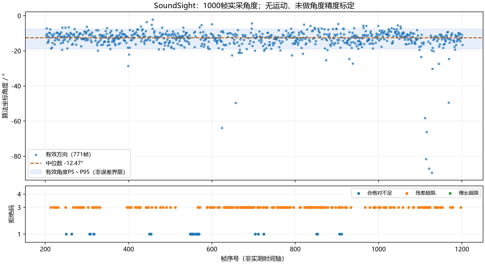

# 1000帧真实声音：角度与拒绝分析

这轮计算方向主要集中在算法坐标的 **−13°附近**。1000帧完整保存、序号连续、零故障和零丢帧；但角度仍有抖动和少数偏离很大的有效输出，不能据此宣称定位准确或可以直接驱动转台。

## 原件与复核范围

原件为用户从SD卡提供的`soundsight-board-ram-1000-001.zip`，已逐字节核对归档副本与H盘原件相同，ZIP CRC检查通过。包内16份JSONL均可解析（其中启动失败的002文件为空，按原样保留），包括此前失败、恢复、BIST及RAM修复后日志。本分析直接读取完整`ram-real-1000-001.jsonl`，不是根据串口末尾几行推算。包中没有ARM-RESULT，ARM数值对照原件仍待补。

本轮有1000条帧记录、1条启动事件及1条结束事件。序号202..1201连续，所有帧fault/drop/API状态均0，motion_requested均false。记录显示host在CPU0、worker在CPU1，结束计数1000且无提前停止；终端另报告1000帧成功落盘、队列峰15，结束后寄存器为STATUS=0x14000、FAULT=0x40、DROPS=0。后两项来自此前串口，不伪装成ZIP内部数据。

## 角度是多少

仅对`direction_valid=1`的771帧统计，权威角度为`angle_q8 / 256`。拒绝帧的角度字段0不算声源0°。

| 指标 | 数值 | 含义 |
|---|---:|---|
| 方向有效 | 771/1000，77.1% | 通过当前算法检查的比例，不是准确率 |
| 环形平均角 | −13.22° | 按角度绕圈处理的平均方向 |
| 中位角 | −12.47° | 一半有效角度在其两侧，受极端值影响较小 |
| P5～P95 | −18.89°～−7.48° | 中间约90%的有效角度范围，不是相对真实方向的误差界限 |
| 最小/最大 | −89.34° / −2.12° | 包含偏离较大的有效输出，未偷偷删除 |

上一轮003的98帧有效输出，环形平均−10.97°、中位−10.36°。两轮均主要靠近算法0°的负角侧；没有实际声源方位测量，不能把差值当作定位误差。算法坐标与PCB朝向/观察者左右的对应仍需通道和几何标定，不能仅凭负号说“左边13度”。



逐帧表为`angles-1000.csv`：包含全部1000帧、有效标志、角度、拒绝码、合格对数、故障/丢帧及六对mask。拒绝帧的角度列留空。

## 229帧为什么被拒绝

| 原因码 | 帧数 | 根据合同能确认的含义 |
|---|---:|---|
| 1 | 33 | 通过筛选的麦克风对少于3组：0/1/2组合格分别22/8/3帧 |
| 3 | 195 | 各对时差拟合为同一个方向后，残差超过门限 |
| 4 | 1 | 求解向量的模长未通过范围检查 |

**更正此前回复的加总错误：不足对数是33帧、残差拒绝是195帧，不是35和193。** 用户回传的分类明细与ZIP原件完全一致，数据没有变；此前是我汇总算错。有效771帧和拒绝总数229不受影响。

21帧六对mask均0，全部为PHAT阶段REJECTED(2)、IFFT阶段SKIPPED(6)。其中13帧集中在序号549..569，具体分布见`angle-analysis.json`关联的逐帧CSV；其余散落在308/316/317、450/453/454、711、911。这说明有成段的输入/筛选退化，但没有原始PCM或声源操作同步记录，无法区分音乐间隙、量化归零或采集链原因；energy=0也不能作为静音证据。

残差拒绝分散在各100帧分段，每段9～35帧。分段有效角中位数在−13.66°～−11.32°之间，没有看到方向中心持续单向漂走；有效率分段为85/87/78/74/65/71/69/83/82/77%，存在恢复，不能直接归因为运行越久越坏。

## 已标有效但偏离很大的样本

| 帧序号 | 角度 | 合格麦克风对 |
|---|---:|---:|
| 1128 | −89.34° | 6 |
| 1121 | −87.00° | 6 |
| 1114 | −81.62° | 6 |
| 1115 | −66.28° | 6 |
| 624 | −63.86° | 5 |
| 1111 | −58.24° | 6 |

这些帧不是因为合格对数太少被强行算出；多数6组都合格，仍与主要方向相差很大。具体原始六对words和求解向量保存在`angle-analysis.json`的`farthest_valid_samples`。不能仅以“valid=1”把它们当作准确指向，也不把这些离群值从统计里删掉。

## 下一步与边界

先以固定位置、固定音量的宽带声音做受控对照，并记录实际方位；比音乐更容易区分声源频谱变化与算法问题。进一步定位时需同步PCM/频谱或配对层诊断，单靠当前峰值摘要不能确定声学根因。不直接放宽门限，不直接把这组未标定角度接到执行器。此轮没有修改RTL、求解器、位流、SD启动文件或公共ABI，也没有运行新的板端动作。

1000帧通过支持本次RAM缓冲解决逐帧SD同步阻塞问题；不等于长期稳定性、高水位停机、角度精度或机械闭环验收。板上20秒启动等待仍为命令临时覆盖，永久修复包未确认安装。

在仓库根目录复现分析（Python；画图需要matplotlib）：

```text
python tools/analyze_pynq_board_angles.py document/evidence/pynq-board-20261021/soundsight-board-ram-1000-001.zip document/evidence/pynq-board-20261021
```

分析脚本只读取ZIP并写分析产物，不连接硬件；原ZIP保留完整失败和成功日志，不解压覆盖工程。
