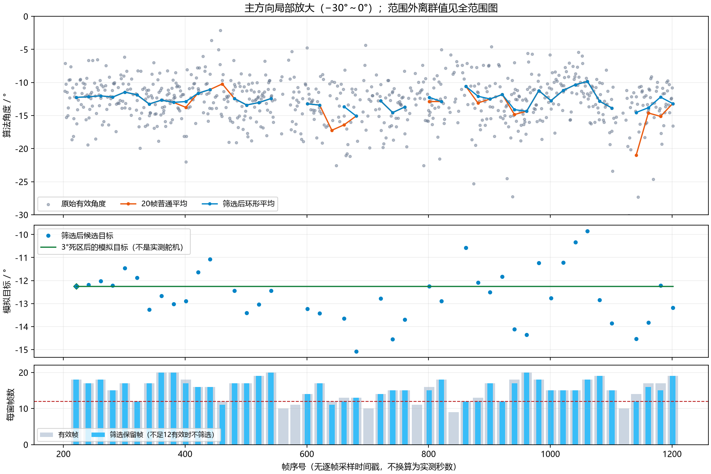

# 1000帧离线回放：多帧平均能否减少跳角

**这份记录上有效：筛选后目标的跨度从普通平均的11.14°缩小到5.23°；加3°死区后，模拟只产生首个目标−12.25°，后续没有新的目标更新。** 这说明对本次主要方向稳定的数据有抑抖作用，不证明定位精度或移动跟随性能。没有访问板卡、调用PYNQ、写MMIO、启动采集或驱动舵机。

## 输入和试验规则

输入为上级目录原始ZIP中的`ram-real-1000-001.jsonl`，完整1000帧（202..1201），771帧方向有效。无效帧不当成0°。原日志、原求解结果、RTL和在线程序均未修改。

- 20个连续到达帧一个窗口，不重叠，共50窗。窗口含无效帧，不为了凑有效数无限等待。
- 只有窗口最后一帧到达后才产生该窗结果，不使用后面的帧，不将结果画回窗口开头。尾部不足20帧不输出（本批恰好整除）。
- **普通平均基线**：至少12帧有效才输出，对这些有效角做算术平均。少于12帧的6窗不输出。
- **筛选后平均**：先满足同样12帧条件；在当前窗口找一个与所有有效角总环形距离最小的样本角作为中心（圆周L1中位代表点）。保留离中心不超过10°的角度；保留数至少12，且不少于当前有效数的2/3，才输出环形平均。否则不产生新估计。
- **3°死区**：候选与上次模拟下发目标的最短角差达到3°才更新；首次没有旧目标时初始化。比较的是上次下发目标，不是上一窗候选，所以缓慢累积移动仍有机会更新。

10°范围及2/3一致性是本次把“排除明显离群点、没有主方向就不更新”落成代码的初始参数；不是从真实角度标定出的指标。本轮采用一次固定参数回放，没有搜索最优参数或删除不利样本。20/12/3°也仍是试验参数。

筛选只参考当前窗口，不参考旧目标方向；避免真实声源换方向后被旧目标永久锁住。两个势均力敌的分离方向应拒绝更新，不能把它们平均到一个不存在的中间位置。普通平均在±180°跨界时会出错，环形平均按最短圆周处理；这份实际数据没有该跨界，相关行为只由人工构造测试覆盖。

## 实测日志回放结果

| 方法 | 输出数 | 输出范围 | 最大相邻输出角差 |
|---|---:|---:|---:|
| 原始有效角度 | 771 | −89.34°～−2.12° | 72.39° |
| 每20帧普通平均 | 44 | −20.99°～−9.85° | 7.13° |
| 筛选后环形平均 | 42 | −15.08°～−9.85° | 3.11° |
| 再加3°死区的模拟目标 | 1次初始化 | −12.25° | 无后续更新 |

“最大相邻输出角差”跨过没有新输出的窗口计算，只是候选数列变化，不是物理角速度；原始与窗口结果更新频率不同。为防止仅因少两个输出导致比较偏差，另比较双方都有结果的同42窗：普通平均范围仍为−20.99°～−9.85°、最大输出角差仍7.13°，筛选后为−15.08°～−9.85°、3.11°。全部指标和50窗明细见`replay-results.json`与`replay-windows.csv`。

42窗通过，8窗不产生新估计：6窗有效帧不足12；另2窗筛选后只有11帧，未达到保留至少12帧的条件。它们没有被补0或伪造成新目标。3°死区没有把42个候选改成一个角度，而是在候选与首次目标都相差不到3°时抑制重复下发。

### 跳角最明显的一窗

序号1122..1141有14帧有效，其中包含−89.34°等偏离主方向的结果：

- 普通平均：**−20.99°**。
- 不筛选、仅改用环形平均：−19.87°，仍然被拉偏。
- 筛选保留12帧后环形平均：**−14.54°**。

因此这里的改善主要来自排除离群角，不能只换成环形平均就称为解决跳角。

## 曲线

灰点为原始有效角，橙线为普通平均，蓝线为筛选后平均。点只在窗口末尾产生，连线只用于阅读趋势；断线表示该窗无新估计。中间面板绿线是上次模拟下发的目标值，**不是实测舵机位置，也不代表无新数据时仍获准运动**。底部显示各窗有效数、筛选保留数；未达到12个有效角的窗口没有执行筛选，保留数显示0。




## 自测与未测边界

10项手工预期测试通过，原始输出见`test-angle-replay.log`：±180°跨界、18个正常角加2个跳角的手算对照、等量双方向拒绝、保留数量/多数比例条件、无效帧和不足窗、真实新方向不被旧目标锁死、死区以最后下发目标为基准、拒绝窗没有新命令、无未来数据与窗口末尾出结果、对向角均值未定义。

测试是作者的功能自测，不冒充第三方复核或板测。没有标定真实方位，输出范围缩小不能称为误差减小；这份日志也不能证明移动声源响应延迟。图横轴保留帧号，没有逐帧采样时间戳，不用取帧耗时拼成声学采样时间轴。

本脚本不是在线舵机控制器：没有实现机械坐标映射、执行器限速、超时失效、STOP或硬件故障控制。真正接入时，STOP/故障须绕过统计等待立即进入原保护流程，过期目标不应继续触发动作；这些不能由本次绿线代替验证。本次也没有证明高水位停机、机械闭环或运动安全。后续应先做受控移动声源的无动作回放/测试，再确定窗口、筛选阈值、死区及真实控制参数。

## 文件和复现

- 分析入口：`tools/replay_pynq_angle_filter.py`（仅离线，不被在线入口导入）。
- 自测：`software/tests/test_angle_replay.py`。
- 原件：上级目录`soundsight-board-ram-1000-001.zip`。
- 本目录：两张图、50窗CSV、JSON结果、本说明和测试日志。没有新增临时工程或复制RTL。

在仓库根目录执行，Python绘图需要matplotlib：

```text
python -B software/tests/test_angle_replay.py -v
python -B tools/replay_pynq_angle_filter.py document/evidence/pynq-board-20261021/soundsight-board-ram-1000-001.zip document/evidence/pynq-board-20261021/angle-replay
```
