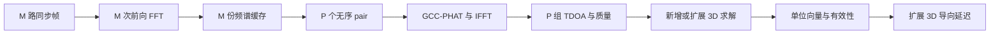
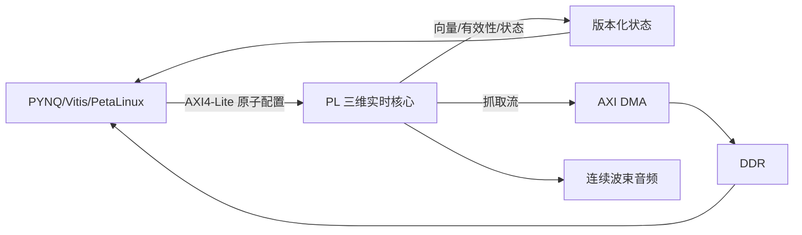
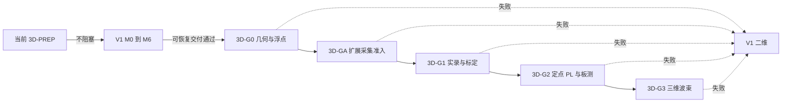

# SoundSight 三维 DOA 工程迁移指南

2026-09-23：V1总验收改为 **2026-10-07**，A/B/C同等承担工程和独立复核，任务以Issue为准。见[工作流](team-workflow.md)与[统一日历](project-plan.md)。本文技术合同保留，不把历史批准扩大为新版本通过。

执行规则更新（2026-09-08）：成员间仅 [H1 最小接口 → H2 首批诊断数据 → H3 算法包集成评审](three-handoff-workflow.md)。暂定接口可版本化用于工程框架、读取器、逻辑/TB和离线算法开发；短实录不等一小时长稳，但只作诊断。A/B/C按各自任务负责技术开发和判断；一个工作包一个负责人和合格非作者复核人。以下冻结/阶段门用于对应接板、正式集成或验收声明，不禁止独立离线工作；完整包交付而非逐小动作审批。

日期：2026-09-07。状态：`3D-P2` 现行工程预研指南；六麦第一轮浮点/合成证据已形成，完整 3D-G0 与 3D-GA 尚未通过。本文不修改现有 RTL、Vivado 工程、寄存器地址或接口合同。

## 1. 结论与使用边界

V1 保持四麦二维，目标 2026-10-07；V2 本轮声学评审与软件模拟只针对“水平正方形四麦＋上下各一麦”的六麦阵列。按用户最新收窄要求，取消本轮新增四麦三维模拟、四/六麦比较及六路抽四路试验；非共面四麦仅作为未来重新决策的背景备选，八麦暂缓。六麦仍是待验证候选，没有采购授权，也无需先完成四麦三维产品。

从 V1 扩至六麦需要扩展采集、抽取/预处理、缓存、通道映射、十五对计算、求解、延迟线和 DMA 搬运。可以复用每通道每帧一次 FFT、GCC-PHAT、版本管理和验证方法，但不能把六麦描述为只增加三维求解模块。以下用 M 表示配置的采集通道数，N 表示 FFT 长度，H 表示 hop，P 表示选用的无序通道对数；全 pair 时 P=M(M-1)/2。本轮 V2 取 M=6；四/八麦数字仅解释预算尺度和历史兼容，不派生新试验任务。

正式三维实现必须等 V1 的 M0～M6 完成可恢复验收；目标日期仍为 2026-10-07。主流程已开展获授权的六麦声学评审及 3D-G0 离线软件模拟，后续离线改进仍可继续，不能代替 V1 或扩展采集准入。本轮工程文档整理只同步已有证据，不重复模拟或修改实现。正式扩展采集还须 V1 保底门及 3D-G0 通过后，进入 3D-GA 单独审核和授权。

麦克风沿用用户原选的 IM73D122V01/PDM 路线，本轮不重新选型、不更换接口；具体模块、声孔位置、供电电平、PDM 时钟负载和六路接线仍需真实资料及测量。用户选定型号不等于模块已核验或六路硬件已验收。

V2 的结果是指向声源的单位向量、方位角和俯仰角，不包含距离、三维位置或离地高度。六麦数量和非共面几何本身都不是精度保证；还必须证明几何矩阵满秩、条件数可接受，并在坐标、固定延迟误差和异常通道下保持稳定。当前决策以更新后的主计划为准，旧“四通道限定”已撤销。

本指南基于[三维方向升级计划](three-dimensional-doa-plan.md)及用户随后“本轮只六麦”的范围收窄，与[工程实施流程](engineering-flow.md)、[系统架构](architecture.md)、[PYNQ 集成指南](pynq-integration-guide.md)和[四路样本合同](../hardware/four-channel-sample-interface-contract.md)共同使用。若共享计划仍有四/六比较条目，交主流程同步，本文件不据此新增四麦任务。

### 1.1 当前六麦软件证据

[第一轮软件评审报告](six-mic-acoustic-software-review.md)已记录 2700 帧、21 个自检通过，以及独立临时目录复跑的 15 个产物哈希一致。本轮整理依据这些已有记录，没有重新运行模拟。正式入口为[六麦声学评审材料包](../deliverables/six-mic-acoustic-review-v1/README.md)，工程阶段与分派见[当前状态](current-status.md)、[工作包](work-packages.md)和[项目计划](project-plan.md)。

| 已有结果 | 工程解读 |
|---|---|
| 同频带约 0 dB 输入噪声，球面误差 P50/P95 为 4.82°/10.20°，有效率 47% | 有效帧精度不能掩盖大量拒绝；未达到候选 90% 有效率门槛 |
| 等强竞争声源，有效率 26%，有效输出条件错误率 66.67% | 目标选择/选峰未解决；不能宣称完整 3D-G0 通过 |
| 同组六路合成输入的 B/C 相对 A 的 SIR 改善 5.65/5.29 dB | 单个有利带限干扰场景；不是自然语音、实测 SNR 或 M5 通过 |
| C 用 81 个有效帧方向的平均值作静态指向，尝试 186 帧、有效率 43.55% | 不是逐帧在线更新，未验证 steering 切换、连续跟踪或端到端时限 |
| 符号、自零输入拒绝和逐只剔除后的几何秩自检通过 | 仅对应所测合成模型；不等于自动坏通道检测、实际遮挡或 RTL 符号链通过 |

模型尚未涵盖实际模块传递函数、PDM 抽取、定点、目标锁定、通道质量加权或自动异常剔除。完整六路采集/抽取/缓存/PHAT/IFFT/求解/搬运预算与 3D-GA 尚未完成，不能由软件运行时间签署 PL 资源、时序或 PYNQ 实板通过。现行四麦 V1 文档继续有效，整理前快照只供[历史追溯](../archive/2026-09-07-before-materials-cleanup/README-ARCHIVE.md)。

## 2. 独立复核发现的阻断项

以下问题是 `3D-G0` 评审及后续 `3D-GA` 合同冻结的阻断项，不能仅凭指南到位判为解决。

| 编号 | 复核发现 | 风险 | 本指南的处理 |
|---|---|---|---|
| E3D-01 | 三维计划定义 `tau_ij=t_i-t_j`、方向向量指向声源，因此采用负号；现有 `README.md` 与 `principles-flow.md` 的求解式使用了正号，但没有同时锁定“入射方向”是否指传播方向 | +x 声源可能输出 -x，波束补偿延时也可能反向 | 不在本任务修改旧文档；把 TDOA 符号单测列为合同冻结前阻断门 |
| E3D-02 | 现有资料已有 `config_version`、阵列坐标和 `geometry_version` 语义，但尚无一份冻结合同把坐标轴、向量语义、pair 顺序、TDOA 正负号和系数版本绑定起来 | 同名版本可能解释出不同方向 | 提出兼容审查清单，不新增字段或地址 |
| E3D-03 | 四麦六对仅三个独立相对到达时间，六麦十五对仅五个；几何矩阵最多三列满秩 | pair 数不等于独立观测数或精度保证，共用通道的误差相关 | 对全部选用 pair 做冗余、残差、闭合与拒绝，并评估误差相关性 |
| E3D-04 | 固定几何的唯一预计算逆矩阵只适用于固定权重；逐帧连续变化的质量权重会改变求解矩阵 | 固定系数与动态权重数学上不一致 | V2 基线优先“固定权重或有效 pair 掩码系数库”；连续动态加权另做资源评审 |
| E3D-05 | 平面阵列的二维结果没有测量俯仰 | 把俯仰写成 `0` 会把“未知”伪装成“已测水平” | V1 保持原方位语义；未来兼容输出必须把俯仰标为无效/不支持 |
| E3D-06 | 四麦或六麦非共面均不自动给出良好精度；很小的竖直孔径、坐标公差或遮挡会使三维解失效 | 合成数据可过而实板俯仰失效 | `rank(A)=3` 只是最低门，还要评估奇异值、条件数和误差传播 |
| E3D-07 | 三维布局可能改变最大基线，因而改变每对合法 lag 和波束延迟跨度 | 沿用二维硬编码范围会漏峰或越界 | 所有 lag 与延迟上限从版本化实测坐标生成，不手填散落常数 |
| E3D-08 | 六路采集、抽取、DMA 格式与复位恢复尚未准入 | 错位六路数据可能被旧四路客户端静默误解码 | 增加 `3D-GA`，版本/通道数/长度不支持时明确拒绝；一小时全通道长稳单独实测 |

主流程最先需要处理 E3D-01：在一份规范中明确 pair `(i,j)`、互功率谱操作数顺序、IFFT lag 索引、`tau_ij` 定义、方向向量语义和导向延迟公式，并让 +x/+y/+z 的可判定用例贯穿模型、RTL 与驱动。只改公式而不改测试向量不能解除风险。

第一轮六麦模型已有 TDOA/GCC 符号自检，因此 E3D-01 不再是“完全没有模型证据”；仍未完成旧文档语义、人类签核、位精确模型、RTL 与驱动的端到端统一，阻断项不能直接关闭。

## 3. 复用与新增边界

### 3.1 数据路径边界

下表四麦列只说明历史复用边界，不构成本轮四麦三维开发或验收要求。

| 工程对象 | 四麦备选的历史复用边界 | 六麦三维首选候选 |
|---|---|---|
| 采集与通道映射 | 四路 bundle 与时基可复用；重装后重验 | 六路共享时基、接收槽位/引脚、映射、复位和完整样本组重新准入 |
| 抽取/预处理 | 四路状态与滤波结构回归 | 六路独立滤波状态；共享运算器需证明服务速率和通道隔离 |
| 分帧与前向 FFT | 每帧 4 次前向 FFT | 每帧 6 次前向 FFT；`frame_id/channel_id` 随数据传播 |
| 频谱缓存 | `X0`～`X3` | 扩至六份；容量、端口冲突和 ping-pong 覆盖期限重算 |
| 通道对 | 全 pair 为 6 对 | 全 pair 为 15 对；pair 顺序、符号、掩码版本化 |
| GCC-PHAT/IFFT/峰值 | 6 次 pair 处理/IFFT | 15 次 pair 处理/IFFT；PHAT 服务能力及低能量状态同步扩展 |
| DOA | `A` 为 6x3，固定映射为 3x6 | `A` 为 15x3，固定映射为 3x15；重验残差、掩码、模长和极点 |
| 波束形成 | 四路延迟线与 A/B/C 回归 | 六路延迟线、插值、累加和归一化；仍由统一 A/B/C 切换点控制 |
| PS/PYNQ 与导出 | 旧原始格式保留；三维结果需兼容评审 | 新六路 DMA 格式、缓冲长度和驱动能力核验；旧客户端明确拒绝 |

六麦必须重新标定坐标、固定延迟和增益；旧平面录音不能套新几何。每对合法 lag、steering 上限与 golden 由同一几何清单生成。PYNQ 只消费版本化接口，实时求解和逐样本波束仍由 PL 完成。

只有四麦备选维持 4 次 FFT/6 个 pair；六麦的新增成本遍及采集到导出整条链。若以后改用球面 SRP-PHAT，候选网格与调度属于另一条架构变更，仍需新预算。

### 3.2 模块边界建议

不要求立即改模块名。V2 设计评审时，应能在逻辑上区分以下职责：

| 逻辑职责 | 输入 | 输出 | 不能做的事 |
|---|---|---|---|
| `pair_consistency` | P 对 TDOA、pair 质量、有效掩码 | 闭合误差、有效 pair 掩码、拒绝原因 | 把互相矛盾的峰强行归一化成方向 |
| `doa_solver_3d` | 同一帧 TDOA、匹配的三维系数 | 原始 `ux/uy/uz`、残差、原始模长 | 在 PL 做通用浮点矩阵求逆 |
| `doa_valid_3d` | 原始向量、残差、pair 质量、历史状态 | 单位向量、有效标志、无效原因 | 仅凭归一化把超物理解判为有效 |
| `direction_format` | 有效单位向量 | 方位/俯仰及各自有效标志 | 在极点伪造唯一方位角 |
| `steering_delay_3d` | 手动或自动单位向量、坐标、声速 | M 路成组延迟参数与版本 | 在一个样本组内只更新部分通道 |

`direction_format` 可以在后续资源评审中选择：若角度只供显示，PL 的规范结果可以是单位向量、残差和有效性，PYNQ/Vitis/PetaLinux 的共用后端库再换算角度；实时波束仍直接由 PL 单位向量驱动。若比赛接口要求硬件直接输出角度，则把角度换算及其 CORDIC/开方成本计入 PL。两种方案都不允许把定位求解或导向延迟移到 Python。

## 4. 符号、坐标与几何审查

### 4.1 建议作为 golden reference 的符号链

以下是供 `3D-G0` 评审的参考定义，不是对现有合同的即时修改：

1. `r_i=[x_i,y_i,z_i]^T` 是 `mic_i` 在设备坐标系中的实测声学位置。
2. `u` 是从阵列原点指向声源的单位向量。
3. pair 固定按 `(i,j)`、`i<j` 枚举。
4. `tau_ij=t_i-t_j`。若相关定义采用 `Xi*conj(Xj)`，必须用冻结的 FFT/IFFT 约定和脉冲向量实证其峰值 lag 是否等于该 `tau_ij`。
5. 远场近似下：

$$
c\tau_{ij}=-(\mathbf r_i-\mathbf r_j)^T\mathbf u.
$$

若令第 p 行 `A_p=(r_i-r_j)^T`、`b_p=-c tau_ij`，则：

$$
A\mathbf u=\mathbf b.
$$

任何实现可以选择相反的 TDOA 定义或传播方向向量，但必须成组改变相关峰符号、`b` 的构造、角度解释和波束延迟，不能只改其中一处。

### 4.2 三维可观测性与条件数

M 个阵元的全 pair 数为 M(M-1)/2，但相对到达时间空间只有 M-1 个自由度：四麦为 3，六麦为 5，八麦为 7；远场方向的几何矩阵列秩至多为 3。共用麦克风的 pair 误差相关，不能以独立同方差假设宣称十五对的精度增益。对选中的行构成 `A_S`：

- `rank(A_S)<3`：不能求完整三维方向，整帧或该掩码无效；
- `rank(A_S)=3`：只说明代数上可解；
- 最小奇异值过小或条件数过大：坐标、TDOA 和定点误差会被放大，应在设计期拒绝该几何/掩码，而不是等板测后靠平滑掩盖。

建议在 `3D-G0` 对六麦候选几何保存：`A`、奇异值、条件数、设计支持的有效掩码的秩/条件数、坐标公差扰动结果、TDOA 量化与固定延迟残差的方向误差。本任务只定义审查项，模拟由主流程执行。具体条件数上限由目标误差与噪声依据倒推后冻结，当前没有证据给出通用阈值。

选用的 TDOA 还应按同一符号约定检查闭合，例如：

$$
\tau_{ij}+\tau_{jk}+\tau_{ki}\approx0.
$$

闭合通过不保证方向正确，但闭合明显失败说明不同 pair 很可能选中了不相容的峰。六麦可在合理几何下剔除任意一只后保留非共面阵列，但必须逐一检查剩余子阵列的秩、条件数和实录指标；已知故障编号后屏蔽成功不证明自动识别故障成功。屏蔽一麦应同时屏蔽所有关联 pair，不能保留污染项。四麦备选损失整只麦后仅剩三麦，不能无额外先验保证全空间三维。

### 4.3 2D 兼容语义

当四麦仍位于同一平面时，几何矩阵的垂直列为零或与其他列相关，未知俯仰不可观测。单位模长只能在额外半空间假设下给出俯仰绝对值候选，不能消除上下镜像，也会在水平附近放大误差。因此：

- V1 的方位结果继续只表示冻结平面内的二维估计；
- 任何未来统一结果结构都必须设置 `elevation_valid=0` 或等价“不支持”状态；
- 不得用 `elevation=0` 且有效来兼容旧消费者；
- 三维回归以球面单位向量夹角为主；二维回归比较环绕正确的方位误差与原有声学指标，不伪造三维向量或俯仰真值。

### 4.4 三维导向延迟的符号闭环

在本节参考定义下，远场到达时间可写为 `t_i=T-r_i^T u/c`。为了用因果延迟把各路对齐到最晚到达时刻，可采用：

$$
d_i=\frac{\mathbf r_i^T\mathbf u-\min_m(\mathbf r_m^T\mathbf u)}{c},
\qquad
y[n]=\frac{1}{M}\sum_{i=0}^{M-1} x_i[n-f_s d_i].
$$

上式适用于全部 M 路启用、等权求和。若屏蔽通道，求和集合、延迟参考和增益分母必须随有效通道集合成组更新；空集合无效，不能除零。实际实现还需量化为整数/分数采样并处理插值群时延。该公式只有在 `u`、采样延迟算子和通道坐标采用本节定义时成立；若合同最终选择另一符号，必须由同一个生成器同时产生 TDOA golden 和 steering golden。

最低符号测试覆盖 +x、-x、+y、-y、+z、-z 以及至少一个斜向合成波前，逐项核对：各通道到达先后、每对 peak lag、求解向量、角度、M 路补偿延迟和相干求和峰值。+z/-z 用例只有在非共面候选中才具备判别力。

## 5. 固定几何与动态权重

### 5.1 固定权重

当坐标、pair 集合和权重 `W0` 固定时，可以离线预计算：

$$
P_0=(A^T W_0 A)^{-1}A^T W_0,
\qquad
\hat{\mathbf u}_{raw}=P_0\mathbf b.
$$

固定系数矩阵为 `3 x P`：四麦全 pair 每组 18 个常系数，六麦 45 个，八麦预算对照为 84 个。若把 `c/fs`、TDOA 的 Q 格式或单位换算吸收到系数中，生成物必须记录该尺度。离线生成建议用 QR/SVD 求解并检查条件数，上式表示数学映射，不要求数值程序显式求逆。

### 5.2 动态质量不能冒充固定矩阵

若每帧使用连续变化的 `W(frame)`，则 `P(W)=(A^TWA)^-1 A^TW` 同样随帧变化，一组 `P0` 不再等价。可选工程路线如下：

| 路线 | 实时成本 | 数学一致性 | 当前建议 |
|---|---:|---|---|
| 固定 `W0`，动态质量只参与拒绝与置信度 | 最低 | 与固定 `P0` 一致 | 作为首个三维硬件基线 |
| 按已评审的有效掩码选择预计算系数组 | 成本随允许的掩码数量增长 | 对列出的离散剔除一致；每个掩码校验秩/条件数 | 优先评估有限故障集合 |
| 对质量量化为少量权重档并建立系数库 | 系数库扩大 | 仅对列出的离散档一致 | 需要证明收益大于复杂度 |
| PL 每帧重算 3x3 加权解 | 除法/求逆、异常与周期成本最高 | 可支持真正逐帧权重 | 只有实录证明必要时评审 |
| PS 低速生成系数并原子提交 | 不占 PL 求逆资源，但有时效/版本风险 | 仅适合缓慢变化的试验配置 | 不用于逐帧质量跟踪 |

四麦六对的全部位掩码为 64 种，六麦十五对为 32768 种，八麦二十八对为 268435456 种；它们包含大量无效组合。六麦若为每个掩码存放零填充的 3x15 个 24 bit 系数，未经筛选即约需 4.42 MB，仅是理论容量示例，不能再称“小型系数库”。建议先评审完整阵列加六种单麦剔除，共 7 组，再按实录需求加入有限 pair 剔除方案；所有未支持或病态掩码明确拒绝，不能偷偷使用全阵列矩阵。

系数库只能保留 `rank(A_S)=3` 且条件数达标的掩码。PS 更新系数时必须连同系数哈希/版本在安全边界原子生效，PL 在 PS 停止运行时仍能保持最后一组已验证配置或回到冻结默认值。六麦自动异常识别需要单独的污染/误剔除测试；掩码库自身不提供故障识别能力。

## 6. 现有字段兼容与未来合同审查

当前四路样本合同已经规定 `sample_id`、`config_version`、固定通道顺序和三维坐标表；工程文档还使用 `frame_id`、`pair_id` 和 `geometry_version`。这些语义目前分散在不同文档中，并不等于三维寄存器/DMA 结构已经冻结。

本任务不新增字段。正式 V2 合同评审时，至少逐项回答：

| 语义 | 兼容要求 | 未来可评审的表达，不代表已采用 |
|---|---|---|
| `sample_id` / `frame_id` | 三维不能改变其连续性和分帧语义 | 原样保留 |
| `config_version` | 一帧内坐标、系数、权重策略、声速和输出模式必须来自同一原子配置 | 继续作为生效快照版本 |
| `geometry_version` | 必须唯一对应 mic 映射、x/y/z 坐标、坐标轴、向量语义、pair 顺序和 TDOA 符号 | 现有名字可保留，但范围需主流程冻结 |
| 标定版本 | 非共面重装后固定延迟/增益必须重测，不能只改 geometry | 可独立 `calibration_version` 或纳入生成清单 |
| 系数版本 | 同一 geometry 可能有不同 Q 格式、掩码库或权重策略 | 可独立 `coefficient_set_id`，并引用 geometry |
| 通道数/顺序 | 六路样本组长度、槽位、字节序、有效/存储位宽必须明确 | 可独立 `channel_count`、通道映射表与格式版本 |
| 通道掩码 | 区分物理采集通道数、当前参与算法通道数；被屏蔽槽位是否仍传输须声明 | 可独立有效通道掩码，关联 pair 掩码 |
| 维度/模式 | 通道数与维度独立：四路可为 2D 或 3D，六路也不能仅凭数量宣称 3D 有效 | 独立 `doa_dimension` 和能力声明；版本及长度显式检查 |
| 方向向量 | 明确是“指向声源”还是“传播方向”，明确 Q 格式和有效性 | `ux/uy/uz` 作为规范结果候选 |
| 角度 | 明确轴、正方向、范围、度/弧度和极点行为 | `azimuth_valid`、`elevation_valid` 分开 |
| pair 数据 | `pair_id` 必须能恢复 `(i,j)`、互功率谱顺序和 lag 符号 | 版本化 pair 表而非依赖代码枚举顺序 |

兼容原则是“新增版本，不重解释旧值”：V1 方位字段的零位、正方向、范围和无效码保持原义；V2 消费者先核对接口版本和 payload 长度。任何一帧只允许引用一组 `config_version + geometry_version + calibration/coefficient version`，版本切换必须发生在帧边界，并与连续波束延迟的安全更新边界协调。

### 6.1 六路格式与 V1 安全拒绝

以下是 `3D-GA` 待冻结的兼容要求，不改写现有四通道合同：

- 六路 DMA 块在解析前核对格式版本、通道数、通道顺序、位宽、样本组数、payload 字节数和块序号。紧凑布局时 `payload_bytes=sample_groups x channel_count x bytes_per_channel`；若有 padding，按显式 stride 校验，不能假设紧凑排列。
- 旧四路客户端面对六路格式必须返回可诊断的不支持错误，且不按四路分组产生音频/方向；缓冲分配和 DMA 启动前完成能力检查。新客户端读取 V1 数据时保留旧含义。
- 本轮不要求六路抽四路转换或试验；兼容验证直接使用已有 V1 格式样例与独立六路格式样例，不能把六路头部的 6 改成 4 冒充 V1 数据。
- 通道数量改变涉及接收器、滤波状态、样本 stride、DMA 长度和缓存所有权，不能只靠帧边界改一个数值。后续合同应规定停止抓取、排空/中止 DMA、受控复位、重新配置和重锁定，再开始新的采集 epoch；禁止一个块混用四路与六路。
- `sample_id` 重启或回卷必须能由启动标识/时间戳等冻结语义区分；所有通道的第一组有效样本和滤波预热边界一致。非法版本、截短块、错误通道顺序、旧系数与新几何组合都必须拒绝。

## 7. 周期、缓存与资源预算方法

### 7.1 周期预算

V2 仍以一个 hop 的可用周期为硬截止：

$$
C_{hop}=f_{pl}\frac{H}{f_s}.
$$

在相同 N、H 和 IP 配置、每通道一次前向 FFT、每个所选 pair 一次 IFFT 的假设下：

| 阵列 | 前向 FFT/帧 | 全 pair IFFT/帧 | 合计变换次数/帧 | 48 kHz、24 bit PCM | 32 bit 容器净带宽 |
|---|---:|---:|---:|---:|---:|
| 四麦 V1/三维备选 | 4 | 6 | 10 | 4.608 Mbit/s | 0.768 MB/s |
| 六麦三维首选候选 | 6 | 15 | 21 | 6.912 Mbit/s | 1.152 MB/s |
| 八麦仅预算对照、暂缓 | 8 | 28 | 36 | 9.216 Mbit/s | 1.536 MB/s |

这是全 pair 工作量，不是 FFT IP 个数，也不是 FPGA 资源倍数。FFT 与 IFFT 的配置开销、延迟和吞吐可能不同，不能直接把 21/10 当作周期或资源增幅。选择部分 pair 后用实际 P 重算，同时验证子图、几何秩、条件数、噪声与故障覆盖；不按数量随意删 pair。

按串行共享计算资源保守累加，一个 hop 内的完整服务需求写为：

$$
\begin{aligned}
C_{frame,3D}={}&C_{acq/decim/pre}(M,H)+MC_{FFT}\\
&+P(C_{pair}+C_{PHAT}+C_{IFFT}+C_{peak})\\
&+C_{consistency}+C_{solve3D}+C_{norm3D}
+C_{valid3D}+C_{angle3D}\\
&+C_{steer3D}+C_{audio}(M,H)+C_{move}+C_{control}.
\end{aligned}
$$

若角度只在 PS/UI 换算，`C_angle3D` 不计入 PL，但 PS 计算不得进入 steering 依赖链。设计评审要同时提交：

$$
\Delta C=C_{frame,3D}-C_{frame,2D},
\qquad
C_{frame,3D,worst}\le U_{max}C_{hop},\quad U_{max}<1.
$$

其中采集/抽取、预处理和连续音频项覆盖 H 个新样本组的服务工作；若 PDM 抽取比为 R，还要预算每 hop 的 MHR 个输入位及多级滤波，不把 PCM 净带宽套到原始 PDM。`C_move` 包含会占用共享资源的缓存读写、DMA 仲裁停顿与调度成本；独立链路的流量另外做带宽证明，避免重复计费或漏算。

硬件流水并行时不能把不同域的周期直接相加：按每个时钟域/共享资源列服务需求、截止时间和 FIFO 水位，以实际调度证明重叠。采集与音频还须满足逐样本时限，不能只看帧平均；固定时钟候选下 H=512、fs=48 kHz 的 hop 约 10.67 ms，端到端延迟另含帧积累、排队、计算和结果传递。共享 FFT/IFFT、乘法器或 CORDIC 时，给出首结果延迟、稳态吞吐、配置空隙、端口冲突和最坏背压。

每个预算条目记录“公式估算/模型测量/RTL 仿真周期/实现报告/实板计数”的证据等级。每通道每帧一次 FFT 是复用规则，不能免除新通道的 FFT 或抽取成本。

### 7.2 缓存与常数存储

| 对象 | V2 预算方法 | 相对 V1 的预期 |
|---|---|---|
| 采集/抽取状态 | M 路解串、CIC 积分/梳状、FIR 抽头与独立状态 | 六路扩展；共享运算不共享通道历史 |
| 重叠帧 | `M x N x Wsample x 缓冲份数` bit | 六路对四路名义容量为 1.5 倍，端口和 BRAM 映射另算 |
| 复频谱 | `M x N x 2 x Wfft x 缓冲份数` bit | 六路缓存和 15 对访问；保留未读完帧，禁止覆盖 |
| pair/PHAT/相关状态 | 整帧存储为 `P x N x Wcorr` bit；流式方案列峰邻域、频点屏蔽和 FIFO | 六麦 P=15；可复用 IFFT，但不能漏记各 pair 状态 |
| 坐标 | `M x 3 x Wcoord` bit | 六麦 18 个坐标分量 |
| 固定系数 | `3 x P x Wcoef x K` bit，K 为支持的系数组数 | 六麦每组 45 系数；掩码库按评审集合预算 |
| 残差/一致性 | P 项预测、误差统计和所选闭合环状态 | 共用 pair 运算可节约，但需列调度 |
| 延迟线 | `M x Dmax x Waudio` bit 加分数延迟抽头 | 通道数、最大几何延迟、校准延迟和更新策略共同决定 |
| DDR 环形缓冲 | `B_store x T_service_max` 加块边界、在途块及余量 | 六路 32 bit 容器净速率 1.152 MB/s，服务停顿上限需实测 |

对全空间导向，延迟跨度上界可从冻结几何生成：

$$
D_{max}\ge
\left\lceil
\frac{f_s}{c_{min}}
\max_{i,j}\|\mathbf r_i-\mathbf r_j\|_2
\right\rceil
+D_{interp\_guard}.
$$

此处 Dmax 是最大索引延迟预算；实际 FIFO/RAM 深度须覆盖当前样本，通常至少 Dmax+1，并计地址回卷和插值抽头。若校准延迟与 steering 共用延迟线，还要计入固定补偿跨度。每个 pair 的合法 lag 使用该 pair 的三维欧氏距离单独生成；相关窗边缘需保留亚采样插值邻点，估计结果再按冻结误差容限检查物理界。`c_min`、插值保护深度和取整规则必须进构建清单。

上表净带宽使用十进制 MB/s，不含帧头、DMA/DDR 对齐、descriptor、SD/网络协议和重传。必须分别证明物理接口时钟/槽位容量、AXI 峰值服务、DDR 并发带宽和存储最坏停顿；满缓冲按冻结策略中止抓取或显式记录丢失，不能反压物理采集。六路一小时 32 bit 紧凑 PCM 约 4.1472 GB，需在准入前规划分块、文件系统限制、可用空间与跨块连续性校验。

### 7.3 资源报告

资源表列六麦三维候选的接收/抽取/滤波、FFT、PHAT、IFFT、峰值、三维乘加、归一化、残差、角度、音频、DMA/AXI、CDC 和 ILA 各自的 LUT、FF、DSP、BRAM、时钟及 IO 需求；可引用已有 V1 预算解释增量，不新建四麦三维工程做比较。系数库另列存储映射和选择时序。实际结论须来自完整 part、Vivado 2025.2 的综合/实现报告；目前属于预算方法，未证明“资源足够”。

## 8. 三维定点位宽台账

V2 不能沿用“DOA 一个角度”的旧台账。至少新增以下行：

| 信号/运算 | 必须记录 | 主要失败模式 |
|---|---|---|
| 采集/抽取/预处理 | M 路原始位宽、抽取增益、滤波累加与逐通道状态 | 六路时分复用状态串扰、缩位增益变化 |
| FFT/互功率谱/PHAT/IFFT | 全精度、逐级缩放或 exponent、低能量阈值和 pair 标签 | 扩展通道后缩放标签错配、阈值失配制造假峰 |
| `tau_ij` 或 sample lag | 符号、单位、整数/分数位、亚采样范围 | 正负号或 sample/second 混用 |
| `b=-c*tau` 或已吸收尺度的输入 | 单位、声速范围、乘法完整精度 | 声速/采样率版本不一致 |
| 三维常系数 | 生成矩阵、Q 格式、量化误差、系数版本 | 小系数量化为零、错误 pair 顺序 |
| 三分量乘加 | 单乘积宽度、P 项累加保护位、截断点 | 病态几何使小分量更易受量化影响 |
| 原始模长平方 | 三个平方和的增长位 | 溢出后错误归一化 |
| 归一化/倒数平方根 | 输入范围、零保护、迭代/LUT、舍入 | 把接近零或超物理解变成合法单位向量 |
| 几何残差与闭合误差 | 预测 TDOA、差值、平方/绝对值、阈值 Q 格式 | 阈值与信号缩放脱节 |
| `ux/uy/uz` | `[-1,1]` 表达、端点、饱和 | +1/-1 不可表示或回绕 |
| 方位/俯仰 | 相位编码或度/弧度、极点无效规则 | 象限、环绕和极点误判 |
| 三维导向点积 | 坐标 x 向量、声速/采样率尺度、累加 | 延迟负值、范围不足 |
| 分数延迟 | 整数/小数拆分、插值系数与群时延 | 跳变爆音、M 路更新撕裂 |
| 音频累加/归一化 | 有效通道数、总和增长位、倒数近似、饱和和增益版本 | 六路不能用右移两位冒充除以六，故障剔除后增益错误 |

P 项求解累加需从乘积宽度加 `ceil(log2(P))` 个增长位起算：四麦六项为 3 位，六麦十五项为 4 位，八麦二十八项为 5 位。音频求和独立按 M 计，四麦为 2 位、六麦与八麦为 3 位。再根据范围、系数和实测决定缩减；最终宽度由浮点、位精确、边界向量和真实录音验证，不能由增长位公式直接宣称精度通过。

定点验收不能只比较 `azimuth/elevation`。应依次比较 pair lag、`b`、三个原始分量、模长、归一化分量、残差、有效性、角度和 M 路 steering delay，记录第一处差异；PHAT 还比较低能量屏蔽、主峰迁移和边界行为。最终同时看球面角误差、有效率和错误率，防止靠拒绝帧隐藏量化失败。

## 9. PL 与 PYNQ/PS 解耦

三维不改变现有控制面原则：

- PL 独立完成逐帧 TDOA 一致性、三维求解、有效性和实时 steering；
- PYNQ 只做配置、状态读取、实验编排、日志、UI 和 DMA 抓取；
- PYNQ 可以离线生成固定系数或在低速配置变更时提交整组系数，但不能为每帧动态求逆后再驱动 PL；
- Python 停止、Notebook 未运行或 Linux 调度抖动时，PL 必须继续使用最后一组已提交配置或进入已冻结安全状态；
- Vitis/PetaLinux 替换 PYNQ 时，方向结果、寄存器、DMA 和中断语义保持一致；
- 领航者板卡 PYNQ 支持仍待 M0 实板验证，不把本指南当作支持证据。

## 10. 阶段迁移与回退

| 阶段 | 工程交付 | 进入下一门的证据 | 回退条件 |
|---|---|---|---|
| `3D-PREP` 当前 | 指南与首轮六麦软件报告已形成；主流程继续已授权的离线改进 | 模型证据及失败边界已登记，完整 G0 仍待复核 | 与 M0～M6 争用即暂停 |
| V1 M0～M6 | 二维链完整、可恢复、目标 2026-10-07 | 现有全部阶段门通过并保存发布副本 | 未通过则继续 V1，不以三维预研绕过 |
| `3D-G0` | 六麦声学评审、离线模拟和完整预算 | 六麦几何、符号、秩、条件数、公差、故障剔除、水平场景和收益门槛评审；不依赖四麦模拟或对比 | 六麦不可行则交主流程重新决策，不自动启动四麦三维任务 |
| `3D-GA` | V1 保底门及 G0 通过后，审核现有 PDM 路线的六路接口与版本化合同，再另行实施扩展采集 | 六路共享时基、复位/重锁定、映射、标定、DMA 一小时长稳及格式拒绝通过 | 同步、格式或导出失败先修采集，不进入 G1 算法验收 |
| `3D-G1` | 冻结六麦非共面坐标和校准的六路真实录音 | 三维浮点指标、上下判别、异常通道、失败样例与复现元数据齐全 | 实录无收益或不可重复则保持 V1 |
| `3D-G2` | 位精确、RTL 自检、Vivado 2025.2 综合实现、实板方向输出 | 逐级 golden、周期、资源、时序和板测分别通过 | 任一门失败则 3D 不进入默认构建 |
| `3D-G3` | 同一组六路三维录音的 A/B/C 波束对照 | A 为同组六路中的固定物理单麦，B 为手动真实指向，C 为自动指向；统一增益/频带/削顶和无效策略 | B 无效查阵列，C 无效查定位；不是四/六麦方案比较 |

旧版 3～5 周估算基于四通道复用，不直接适用于六路扩展。G0 后重新估算 GA 的接收/抽取、合同、DMA 和板级联调工作量；当前不承诺 V2 截止日期。

### 10.1 3D-GA 扩展采集验收清单

| 类别 | 必须提供的证据 |
|---|---|
| 实际 PDM 接口 | 原定麦克风具体模块资料、共同时钟来源及负载、数据线/采样边沿/槽位、电平、供电和引脚容量；不能用器件理论支持替代板级证据 |
| 接收与抽取 | M 路输入可区分码型、独立滤波状态、共同抽取相位、群时延、位宽和饱和一致；共享运算器无跨路污染 |
| 重启与复位 | 冷启动、热复位、采集中复位、外设失锁后重锁；旧 FIFO/滤波/DMA 状态不混入新 epoch，全路有效起点及预热长度可追踪 |
| 通道映射 | 物理编号到接收边沿/槽位、bundle、DMA 文件和几何表逐项吻合；每路单独激励、交换/缺路故障能被检测 |
| 固定差异 | 全 M 路同源测试、固定延迟/增益多次测量及重启后复测；同步证据与可标定偏置分开 |
| 一小时长稳 | 所选采样率与全 M 路同时采集、抽取和 DMA 导出至少一小时；样本/块 ID 无丢失、重复、乱序，计数器与文件长度交叉校验；六路不能用四路结果替代 |
| 导出与过载 | 文件分块连续性、DDR 回卷、SD/网络暂停、DMA 超时/中止/恢复；正常长稳不丢样，故障注入按冻结策略明确报错且不反压物理输入 |
| 兼容性 | V1 客户端拒绝六路/未知格式；新客户端能正确读取 V1；错误长度、通道表、系数版本被拒绝，复位后不沿用过期缓冲 |

复位/重锁定和故障注入是独立测试，不能把它们造成的缺口藏在“连续一小时通过”的统计里。GA 证明采集与导出正确；三维精度和音频收益仍由 G1～G3 验证。

### 10.2 回退规则

回退设计要求：

1. V1 的平面坐标、系数、golden、构建清单和验收结果保留为只读可恢复基线。
2. 非共面夹具应可恢复到 V1 几何；改装后任何旧录音都继续引用旧 `geometry_version`。
3. 未来 3D 功能使用显式构建/运行模式和新版本，默认启用前必须完成二维回归；不能重解释 V1 方位字段。
4. 3D 无效时按冻结保持/静音/固定单麦策略处理。恢复 V1 使用原四路平面硬件映射、匹配几何/标定及原版构建，先停流再受控恢复；本轮不要求开发六路抽四路转换。非共面四麦不能只切模式就冒充原 V1 几何，也不是本轮回退实现任务。
5. M7 转台仍是 M5 后另行评审的可选消费者，不是 `3D-G0`～`G3` 的前置条件，也不能修补三维声学失败。

## 11. 验证矩阵与证据等级

### 11.1 最小验证集合

| 验证项 | 主要检查 | 最早阶段 |
|---|---|---|
| 符号基向量 | +x/-x/+y/-y/+z/-z 的到达顺序、lag、向量和 steering | `3D-G0` 模型 |
| 斜向与极点 | 八象限、近极点、正上/正下；极点方位无效 | `3D-G0` 模型 |
| 几何秩/条件数 | 六麦布局、竖直孔径趋零、掩码掉 pair、坐标公差 | `3D-G0` 模型 |
| 近场偏差 | 球面波真值对比远场解；距离只作为条件 | `3D-G0` 模型 |
| 通道故障 | 正常、逐只已知异常剔除、自动异常识别分别统计；噪声、增益、固定延迟和实际遮挡分开 | `3D-G0` 模拟，`GA/G1` 实录 |
| 扩展采集长稳 | 复位/重锁定、M 路映射、同源标定、全路 DMA 一小时连续性 | `3D-GA` 实板 |
| 四/六路兼容 | 通道数与维度独立、未知版本/长度拒绝、V1 数据回归 | `3D-GA` 合同与实板 |
| 闭合与错误峰 | 注入单 pair 偏差、多 pair 冲突、低能量和混响峰 | `3D-G0/G1` |
| 固定/掩码权重 | 每个启用系数组与直接求解一致，病态掩码被拒绝 | `3D-G0/G2` |
| 位精确逐级 | TDOA 到向量、残差、有效性、角度、delay 的首差异 | `3D-G2` |
| 周期与缓存 | 最坏 hop、BRAM 端口、系数切换、延迟线回卷 | `3D-G2` |
| 二维回归 | V1 所有方位、A/B/C、无效策略和 PS 接口不退化 | 每个 V2 门 |
| PYNQ 退出/替换 | Python 停止与 Vitis/PetaLinux 后端不改变 PL 正确性 | `3D-G2` 板测 |

### 11.2 声学指标

三维主误差采用真实与估计单位向量的球面夹角：

$$
e_{3D}=\arccos\!\left(\operatorname{clamp}
(\mathbf u_{true}^T\mathbf u_{est},-1,1)\right).
$$

方位/俯仰误差只作为辅助；极点附近方位无定义。按照三维计划同时报告 P50、P95、有效率、全部目标活动帧中的错误率、有效帧中的条件错误率、上下反号率、无效原因和更新延迟。计划中的 `P50<=5 deg`、`P95<=15 deg`、有效率不低于 90%、错误指向率不高于 5% 等仍是拟议目标，必须在 `3D-G0` 后、正式评价录音前冻结，不是当前结果。

### 11.3 证据声明

| 内容 | 当前证据等级 |
|---|---|
| TDOA 符号、平面阵列镜像、M-1 个相对到达时间自由度 | 理论推导及已测模型符号用例；合同/RTL/驱动一致性仍待验证，十五对不等于十五个独立观测 |
| 本轮只六麦评审/模拟；四麦保留 V1 背景，八麦暂缓 | 用户最新范围，非六麦硬件冻结或采购授权 |
| 4/6/8 麦全 pair 的 10/21/36 次变换、码率、系数库量级 | 给定假设下的理论计算，不是资源报告或运行结果 |
| 固定矩阵、周期/缓存/位宽方法 | 工程方案与预算方法 |
| 条件数上限、最终 Q 格式、周期余量、资源占用 | 待模型/综合验证 |
| 三维 P50/P95 与 A/B/C | 首轮六麦合成结果已形成且存在明确失败；仍待自然语音、真实房间/六路实录及连续跟踪验证 |
| Vivado 2025.2 时序、Overlay、PYNQ/DMA 与三维实板运行 | 待 RTL、实现和实板证据 |

## 12. 交付检查清单

本指南完成后，主流程应把以下事项作为后续决策，而不是立即实现：

- [ ] 统一 E3D-01 的 TDOA/方向/延迟符号，并修正旧文档中的冲突；
- [ ] G0 评审六麦的声学结果、几何和完整预算，冻结六麦试验配置及有限故障掩码集合；
- [ ] V1 与 G0 通过后再审核 GA 的 PDM 扩展证据、版本化合同及一小时长稳方案；
- [ ] 冻结 `geometry_version` 的精确范围，以及标定/系数是否独立版本化；
- [ ] 决定 V2 首个硬件基线采用固定权重还是有效 pair 掩码系数库；
- [ ] 决定规范 PL 输出是单位向量还是同时输出硬件角度；
- [ ] 在 `3D-G0` 用实际候选坐标生成 lag、系数、条件数和误差预算；
- [ ] 保留 V1 可恢复构建与二维回归，再授权三维 RTL 或合同变更。

本文件到位只表示 `3D-P2` 指南完成，不表示 V1、`3D-G0`、`3D-GA`、`3D-G1`、`3D-G2` 或 `3D-G3` 通过。
