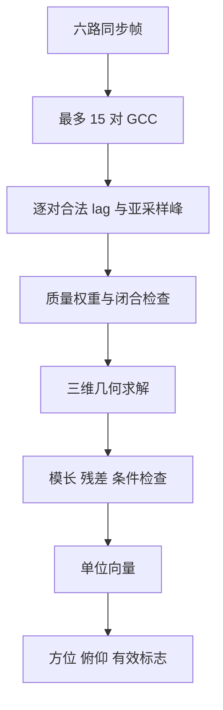

# SoundSight V2 六麦三维 DOA 原理与声学评价指南

2026-09-23：V1总验收改为 **2026-10-07**，A/B/C同等承担工程和独立复核，任务以Issue为准。见[工作流](team-workflow.md)与[统一日历](project-plan.md)。本文技术合同保留，不把历史批准扩大为新版本通过。

执行规则更新（2026-09-08）：成员间仅 [H1 最小接口 → H2 首批诊断数据 → H3 算法包集成评审](three-handoff-workflow.md)。暂定接口可版本化用于工程框架、读取器、逻辑/TB和离线算法开发；短实录不等一小时长稳，但只作诊断。A/B/C按各自任务负责技术开发和判断；一个工作包一个负责人和合格非作者复核人。以下冻结/阶段门用于对应接板、正式集成或验收声明，不禁止独立离线工作；完整包交付而非逐小动作审批。

日期：2026-09-07。状态：3D-P1 轻量预研指南；不是 V1 验收条件，也不是三维能力已通过的声明。

## 1. 范围与证据边界

V1 继续按既定 M0～M6 路线完成二维水平声源方向、可靠性和音频收益验收，目标日期为 2026-10-07。本任务仅修订指南；主流程已获准开展六麦声学评审和离线模拟，不受本任务文件编辑边界限制。

本指南沿用[三维升级计划](three-dimensional-doa-plan.md)的 V1 与阶段门，并以用户最新范围收窄为准：V2 当前评审和模拟只研究水平正方形四麦加中心上下各一麦的六麦候选。取消本轮新增四麦模拟、四/六麦对比和六路抽四路任务。非共面四麦只作理论背景及未来重新决策的备选，八麦暂缓。六麦具体几何仍待 G0 评审，不代表采购或扩展实现获准。

沿用用户原先选定的 IM73D122V01/PDM 路线，本轮不重新选型或更换接口。具体模块、声孔坐标、电平、共享时钟、扩展负载和同步采集仍需可追溯证据；器件路线选定不等于模块或硬件验收通过。

主流程已获准开展六麦声学评审和 3D-G0 离线模拟，并已形成 2700 帧、21 项自检和独立复跑一致的第一轮记录。这属于几何/算法软件预研，可在 V1 期间执行；与 V1+G0 后才进入 GA 扩展采集实施并不冲突。本次只整理文档，不重复模拟；已有结果不等于完整 3D-G0 通过。

V2 的输出定义为：

- 方位角 azimuth；
- 俯仰角 elevation；
- 从阵列中心指向声源的三维单位向量；
- 每个输出的有效标志、置信度和失败原因。

V2 不估计距离、三维位置或离地高度。测试中的距离与高度只是真值和场景元数据，不能作为设备输出。

| 标签 | 含义 | 当前状态 |
|---|---|---|
| 理论结论 | 由几何、线性代数和传播模型直接推出 | 可用于设计约束 |
| 拟议指标 | 用于规划测试的候选门槛 | 未冻结、未验证 |
| 模拟证据 | 合成波形或离线模型结果 | 六麦 2700 帧、21 项自检与独立复跑一致；低带内 SNR 和等强竞争仍失败 |
| 实录证据 | 六路同步录音的离线结果 | 尚无三维验证证据 |
| RTL/实板证据 | 位精确、综合时序和板上输出 | 尚无 |

关联入口：[三维升级计划](three-dimensional-doa-plan.md)、[现行 V1 二维原理](principles-flow.md)、[声学性能验证计划](acoustic-validation-plan.md)、[六麦软件评审报告](six-mic-acoustic-software-review.md)、[独立材料包](../deliverables/six-mic-acoustic-review-v1/README.md)。执行状态与分工以[当前状态](current-status.md)、[项目计划](project-plan.md)、[任务包](work-packages.md)为准，赛题映射见[比赛验收](competition-acceptance.md)。历史快照集中于 `archive/`，现行 V1 文档不是废弃旧方案。

### 1.1 六麦当前基线：可引用结果与失败边界

现有脚本采用水平 40 mm 正方形及中心上下 $z=\pm28.284$ mm，15 对 GCC-PHAT、亚采样峰和无权最小二乘，带模长/残差拒绝；不是本指南后文提出的完整加权、锁定或异常识别链。几何尺寸尚未实物冻结，原 IM73D122V01/PDM 仅是器件路线，合成数据不包含其真实模块响应。

| 用例 | 球面 P50/P95（仅接受帧） | 有效率 | 结论边界 |
|---|---|---:|---|
| 同频带独立噪声约 0 dB | 4.82° / 10.20° | 47% | 未达到 ≥90% 的候选有效率门槛 |
| 等强竞争声源 | 40.07° / 75.31° | 26% | 相对指定目标，>30°错误占全部目标帧 17.33%、有效帧 66.67%；未实现目标锁定 |

不能把全频白噪声名义 0 dB 的结果冒充带内 0 dB：前者在 300～4000 Hz 内约为 8.03 dB。两条合成反射不等于真实房间 RT60，单套安装误差不等于多次标定统计。独立复跑一致证明计算可复现，不是独立算法交叉验证。21 项自检中的逐只剔除几何秩不代表剔除后的波形精度、自动坏麦识别或物理遮挡通过。

同组六路合成 A/B/C 的 B-A/C-A SIR 改善约为 5.65/5.29 dB，只覆盖有利带限噪声探针场景。C 是 186 个尝试帧中 81 个有效方向的整段向量平均（43.55%），不是逐帧跟踪；不得用连续输出音频掩盖拒绝率。自然语音、真实录音、目标锁定/重捕获、动态方向延迟和板上声学收益仍无通过证据。完整数据、分母和复现记录统一引用上述软件评审报告，不将这些六麦结果回填成 V1 四麦成绩。

## 2. 坐标、方向和 TDOA 符号

采用右手坐标系：$x$ 朝设备正前方，$y$ 朝左，$z$ 朝上。方位角 $a$ 从 $+x$ 朝 $+y$ 为正，俯仰角 $e$ 从水平面朝 $+z$ 为正。指向声源的单位向量定义为

$$
\mathbf u_{\mathrm{src}}=
\begin{bmatrix}
\cos e\cos a\\
\cos e\sin a\\
\sin e
\end{bmatrix}.
$$

反向换算为

$$
a=\operatorname{atan2}(u_y,u_x),
\qquad
e=\operatorname{atan2}\!\left(u_z,\sqrt{u_x^2+u_y^2}\right).
$$

上述三角函数推导按弧度计算；文件、寄存器或 UI 必须随字段声明 `angle_unit`，不得在未转换时混用度和弧度。

设声源位置为 $R\mathbf u_{\mathrm{src}}$，第 $i$ 只麦克风坐标为 $\mathbf r_i$，则精确传播距离和到达时间为

$$
d_i=\left\|R\mathbf u_{\mathrm{src}}-\mathbf r_i\right\|,
\qquad
t_i=\frac{d_i}{c}.
$$

定义有序时差 $\tau_{ij}=t_i-t_j$。在远场近似下，

$$
c\tau_{ij}
\approx-(\mathbf r_i-\mathbf r_j)^T\mathbf u_{\mathrm{src}}.
$$

负号不是实现细节：若声源位于 $+x$，且麦克风 $i$ 比 $j$ 更靠近 $+x$，则 $i$ 更早收到声音，所以 $\tau_{ij}<0$。若使用声波传播方向 $\mathbf p=-\mathbf u_{\mathrm{src}}$，同一关系写成

$$
c\tau_{ij}\approx(\mathbf r_i-\mathbf r_j)^T\mathbf p.
$$

现有二维文档中的正号“入射方向”方程对应 $\mathbf p$，三维计划明确要求输出 $\mathbf u_{\mathrm{src}}$。主流程必须冻结一个对外语义，并在内部需要时显式取负；不得只改公式文字而保留相反的输出数值。TDOA 符号合同仍是跨文档/接口接入阻断项：现有六麦脚本轴向自检只验证其自身约定，没有完成 V1 的 GCC、寄存器/UI、波束补偿和控制输出联合冻结。

### 2.1 GCC lag 的符号单测

若采用

$$
G_{ij}[k]=X_i[k]X_j^*[k],
\qquad
r_{ij}[\ell]=\operatorname{IFFT}\{G_{ij}[k]\},
$$

在常用 DFT 定义下，若 $x_i[n]=s[n-d_i]$、$x_j[n]=s[n-d_j]$，相关峰应满足

$$
\ell_{ij}=d_i-d_j=f_s\tau_{ij}.
$$

但库、IP 配置或相关定义交换通道顺序后，符号可能反转。因此 synthetic golden 必须包含声源位于 $+x$、$+y$、$+z$ 和对应负方向的单测，同时记录 `pair_i`、`pair_j`、交叉谱乘法顺序和峰值正方向。

## 3. 平面阵列为什么不能直接成为全空间三维阵列

取一个参考麦克风 $0$，对 $M$ 只麦克风定义 $(M-1)\times3$ 基线矩阵

$$
B=
\begin{bmatrix}
(\mathbf r_1-\mathbf r_0)^T\\
(\mathbf r_2-\mathbf r_0)^T\\
\vdots\\
(\mathbf r_{M-1}-\mathbf r_0)^T
\end{bmatrix}.
$$

若所有麦克风都位于 $xy$ 平面，$B$ 的第三列为零，所以 $\operatorname{rank}(B)\le2$。TDOA 只约束 $u_x,u_y$，无法直接观测 $u_z$。无论四、六还是八麦，仅在同一平面增加数量都不能消除上下镜像。

利用单位向量约束最多得到

$$
|u_z|=\sqrt{1-u_x^2-u_y^2},
$$

因此 $+u_z$ 与 $-u_z$ 仍是上下镜像解。增加“声源一定在阵列上方”的半空间先验只能选择一个符号，不能把未观测信息变成测量证据；若真实声源违反先验，系统会稳定输出错误半球。

该反推在水平面附近尤其脆弱：当 $|u_z|\rightarrow0$ 时，平方根对 $u_x^2+u_y^2$ 的误差放大迅速；噪声还可能导致 $u_x^2+u_y^2>1$，使理想公式无实数解。平面阵列可以在受限半空间做带先验的估计，但不能宣称可靠覆盖上下半球。

在正上或正下方向，$u_x\approx u_y\approx0$，方位角本身没有唯一意义。此时允许单位向量和俯仰角有效，但必须令 `azimuth_valid=0`，不能用任意 $0^\circ$ 方位填充。

## 4. 四麦与六麦的几何、冗余和误差

### 4.1 满秩与绝对灵敏度

一般阵列的条件为 $\operatorname{rank}(B)=3$；四麦时 $B$ 为方阵，非共面的几何判据简化为

$$
\det(B)\ne0,
$$

四麦行列式非零等价于四面体体积非零，因此理想远场下三个方向分量可观测。六麦时检查 $5\times3$ 矩阵的列秩，不能直接对它取行列式。满秩表示可求解，不代表噪声、反射或校准误差下达到精度要求。

候选阵列必须同时检查：

1. $\operatorname{rank}(B)=3$；
2. 条件数 $\kappa(B)$，用于评价方向性误差是否严重不均；
3. 最小奇异值 $\sigma_{\min}((f_s/c)B)$ 或等价绝对灵敏度；
4. 每个方向的雅可比和预测角度误差；
5. 每条实际基线长度、合法 lag、安装公差和遮挡。

只看条件数存在缺陷：将一个良好四面体整体缩小，条件数不变，但所有 TDOA 都趋近零，噪声对应的角误差会迅速增大。只把一只麦克风抬高极小距离虽然可能使矩阵满秩，也会得到很小的 $\sigma_{\min}$，实际俯仰不可用。

正四面体仅作理论背景。边长 40 mm 时，高约 32.7 mm，六条基线都约为 40 mm；在 48 kHz、343 m/s 下最大时延约 5.60 个采样。它不保留原 40 mm 正方形 56.6 mm 的对角线孔径；这说明同边长不等于同孔径，但本轮不安排四面体比较或模拟。

### 4.2 六麦候选的几何量级

用 $s$ 表示水平正方形边长，$h>0$ 表示上下麦各自距水平面的高度。一个用于推导的候选为四个水平声孔 $(\pm s/2,\pm s/2,0)$ 与上下声孔 $(0,0,\pm h)$。实际声孔坐标以测量为准。

该布局的全对基线分为：

| 类别 | 对数 | 基线长度 |
|---|---:|---|
| 水平边 | 4 | $s$ |
| 水平对角线 | 2 | $\sqrt{2}s$ |
| 水平麦至上/下麦 | 8 | $\sqrt{s^2/2+h^2}$ |
| 上麦至下麦 | 1 | $2h$ |

当 $h=s/\sqrt{2}$ 时是旋转后的正八面体顶点布局。取 $s=40$ mm，则 $h\approx28.3$ mm，总高约 56.6 mm：12 对长度为 40 mm、3 对长度为 56.6 mm。在 48 kHz、343 m/s、零校准偏置下，搜索整数界分别为 6 和 8；实际最低声速和尺寸公差可能扩大界限。这只是理论示例，不是最终尺寸。

对独立、同方差的每通道到达时间误差，消去公共到达时间后，中心化坐标矩阵 $R_c$ 的 $R_c^TR_c$ 可作为几何信息量参照。本候选有

$$
R_c^TR_c=\operatorname{diag}(s^2,s^2,2h^2).
$$

当 $h=s/\sqrt{2}$ 时三个轴的这一几何量均衡；$h$ 很小时俯仰灵敏度明显变差。但实际 GCC-PHAT 的误差不一定满足独立同方差，仍需带标定、混响和遮挡的模拟与实录。比较参考基线矩阵的条件数时还应固定参考选择或处理共享参考噪声，不能把参考点变化误认为阵列质量变化。

### 4.3 全对数与独立自由度

$$
N_{\mathrm{pair}}=\frac{M(M-1)}{2},\qquad
N_{\mathrm{relative}}=M-1.
$$

| 数量 | 全部无序通道对 | 相对到达时间独立自由度 | 本轮位置 |
|---|---:|---:|---|
| 4 | 6 | 3 | V1 背景；非共面方案仅供未来重新决策 |
| 5 | 10 | 4 | 仅作几何解释 |
| 6 | 15 | 5 | V2 首选候选 |
| 8 | 28 | 7 | 暂缓 |

这里的 3/5 是去掉公共到达时间后的代数自由度，不是统计独立误差数，也不是方向参数维数；远场单位方向只有两个局部角自由度。六麦的 15 对可以增加一致性检验和异常冗余，但不能称为 15 个独立观测，更不能据此承诺精度提升倍数。

共享麦克风使不同 TDOA 误差相关。对角质量权重 WLS 是工程近似；后续用同数据比较协方差 GLS 或稳健损失。若全对协方差因代数冗余而奇异，应使用独立时差基、协方差伪逆或有依据的正则化，不能直接硬求逆。

### 4.4 已知异常剔除与自动识别必须分开

非共面四麦剔除整只麦后只剩三麦，它们必共面，不能无额外先验保证无歧义全空间方向。六麦候选在 $s,h>0$ 的理想结构下，剔除任意一麦后仍保留非共面五麦：删上/下麦时保留水平四麦及另一竖直麦；删水平麦时保留非共线水平三麦与上下麦。但仍须逐个子集检查秩、最小奇异值和误差，不能继承完整六麦精度。

“告诉算法哪个通道坏了并剔除”只验证剩余阵列的能力；自动识别还必须验证能否发现坏麦、是否误删正常麦、识别延迟和恢复行为。单麦污染会影响与它相连的多条 pair，不应把每条异常 pair 当作独立坏源。几何闭合也未必能发现相互一致的固定通道偏置或强反射，因此需要标定和其他质量证据。

理论上六路中任选四路也不一定满秩：水平四路显然共面；上下两麦加一对水平对角顶点同样共面。这项说明不产生本轮抽四路测试任务。五麦三角双锥在非退化布局下也可在剔除单麦后保留非共面四点，可用于解释冗余不只取决于数量；本轮不展开五麦实现。

### 4.5 本轮六麦评审范围

3D-G0 本轮只评审六麦候选：改变水平边长、上下高度或处理参数时，记录最大基线、安装空间、遮挡和标定条件，避免把增大孔径的收益误归于算法。使用相同信号、真值、噪声、频带和评价规则比较六麦自身的配置。

不新增四麦方案、优化四面体或六路抽四路实验。若未来用户重新开启数量比较，再制定等最大基线/等安装空间对照；六路抽四路也不能代替优化四面体的公平比较。这是方法边界，不是本轮交付依赖。

后续完整评审需报告完整六麦和逐只屏蔽后五麦状态的球面 P50/P95、有效率、错误方向、上下误判、A/B/C 音频收益及周期/资源/带宽/延迟预算。当前仅完成逐只剔除的几何秩自检和一路噪声污染基线，不能写成该测试矩阵已完成。后者是六麦单通道故障测试，不是新增五麦产品路线。六麦不达标时先查几何、标定、算法和采集；需要换数量时反馈主流程另行决策。

## 5. 三维估计链路

下图是待验证的候选完整链路，不是当前脚本功能清单；当前基线没有质量加权、目标锁定、自动异常剔除或 SRP-PHAT。已有失败应保留，改进后使用同条件单列对照，不覆盖旧结果冒充基线通过。

二维链路中的同步、预处理、每通道一次 FFT、GCC-PHAT、低能量屏蔽和峰值质量可复用其方法。四麦全对为 6、六麦全对为 15；若只选部分 pair，应检查保留矩阵的秩、灵敏度和异常屏蔽后的覆盖。六麦需扩展采集、滤波、缓存、通道映射和标定，不能描述成只增加三维求解模块。

全对且每对一次 IFFT 时，四麦每帧 4 FFT＋6 IFFT，六麦为 6 FFT＋15 IFFT。10/21 次变换是工作量计数，不是 FPGA 资源倍数。必须重新预算 PHAT、峰值、求解、搬运和调度，在候选 hop=512、48 kHz 下检查约 10.67 ms 的持续吞吐期限；流水线延迟与启动间隔分别报告。

### 5.1 合法 lag、亚采样与标定

每对麦克风的传播 lag 上界由实际距离决定：

$$
L_{ij}=\left\lceil\frac{f_s\|\mathbf r_i-\mathbf r_j\|}{c_{\min}}\right\rceil.
$$

若固定通道延迟以采样点表示为 $b_{ij}$ 且尚未补偿，搜索窗口为

$$
\ell\in[b_{ij}-L_{ij},\ b_{ij}+L_{ij}].
$$

该区间是搜索包络；$b_{ij}$ 为分数采样时，整数搜索端点需向外取整，再对亚采样结果做物理范围检查。未预先补偿的偏置必须在求解前扣除：$\hat\tau_{ij}=(\ell_{\max}+\delta-b_{ij})/f_s$；已经补偿则取 $b_{ij}=0$，不能重复扣除。新增上下麦不沿用水平麦的偏置。

更换二维夹具为非共面夹具后，声孔位置、线缆、模块路径和固定延迟都可能变化，必须重新测量；不得把旧二维录音或标定参数套用到新几何。

竖直灵敏度取决于布局和入射方向；高度不足的布局可能明显弱于水平方向，不能一概认为三维俯仰更差。以 30 mm 纯竖直基线为例，水平附近 5°俯仰变化只对应

$$
\frac{f_s(0.03)\sin5^\circ}{343}\approx0.366
$$

个采样点，而 1 mm 路程差约为 0.140 个采样点。整数峰不够；亚采样偏差、固定延迟残差、声孔坐标公差和声速误差必须进入同一方向误差预算。这里的数量级是理论推导，不是三维精度承诺。

### 5.2 加权求解与有效性

对每个有序通道对定义一行

$$
\mathbf a_{ij}^T=-\frac{(\mathbf r_i-\mathbf r_j)^T}{c},
$$

组成 $A\mathbf u\approx\boldsymbol\tau$。候选解可由

$$
\mathbf u_0=
\arg\min_{\mathbf u}
\sum_{i<j}w_{ij}
\left(\mathbf a_{ij}^T\mathbf u-\hat\tau_{ij}\right)^2
$$

得到。$w_{ij}$ 可综合有效频点比例、峰旁比、峰锐度、边界命中、闭合误差和历史稳定性。

归一化以前必须检查：有效通道对是否仍使几何矩阵满秩、$\|\mathbf u_0\|$ 是否在允许范围、加权残差是否合格、是否存在单对支配。直接执行 $\mathbf u_0/\|\mathbf u_0\|$ 会把严重错误的 TDOA 强行变成表面合法的单位向量。

若动态权重或通道屏蔽改变，$A^TWA$ 也会改变，不能无条件沿用唯一固定逆矩阵。可在模拟后选择有限权重模式并预计算系数，或设计硬件友好的稳健求解；这属于 3D-G0/G2 决策，不在当前指南冻结。

只有加权 TDOA 在实录中仍频繁选择互不相容的反射峰，并导致 P95、有效率或错误方向不达标时，才比较球面 SRP-PHAT。球面候选增多是计算预算问题，但 SRP-PHAT 也不会自动修复阵列病态、标定错误或不足的竖直孔径。

## 6. 输出、球面平滑与极点处理

内部主输出应是单位向量 $\hat{\mathbf u}$。方位和俯仰由单位向量派生，避免直接平均跨越 $-180^\circ/180^\circ$ 的角度。时间平滑优先在向量域进行，平滑后重新检查模长和有效性。

建议输出语义：

| 字段 | 含义 | 无法可靠给出时 |
|---|---|---|
| `direction_unit[3]` | 指向声源的单位向量 | `direction_valid=0`，数值不得被消费者使用 |
| `azimuth` | 水平投影相对 $+x$ 的角度 | 极点附近 `azimuth_valid=0` |
| `elevation` | 相对水平面的角度 | 方向无效时 `elevation_valid=0` |
| `confidence` | 冻结算法定义下的质量量 | 不得解释为概率，除非另有校准 |
| `invalid_reason` | 能量、秩、残差、极点、越界、多峰等原因 | 必须可统计 |
| `geometry_version` / `calibration_version` | 坐标和标定身份 | 不匹配时拒绝处理 |
| `angle_unit` | 方位/俯仰采用度或弧度 | 缺失或不匹配时拒绝解释角度字段 |

V1 不支持俯仰时必须明确标记“不支持/未知”，不能写数值 0，因为 0°表示已经测得声源位于水平面。

### 6.1 目标身份与重捕获

当前六麦基线每帧独立求解，未实现以下策略。后续由手动允许扇区或首次连续稳定方向确定目标：候选连续 `N_acq` 帧通过质量门且方向离散不超过 `delta_acq` 才锁定；锁定后限制在 `delta_track` 内更新，短时无效进入 HOLD 且不标为新有效方向。超过 `T_hold`、目标离开允许扇区、连续几何失败或人工释放后重新捕获；若允许抢占，须冻结 `Delta_Q` 和 `N_switch`，不能随单帧更响声源切换。

三维方向距离用球面夹角，扇区需声明方位/俯仰范围或向量锥约束及极点行为。评估时按预先指定的目标真值评分，不能在失败后改选更接近输出的声源；拒绝和重新捕获时间进入有效率与延迟统计。该规则只锁定方向，不识别说话人身份，当前等强竞争失败不能借事后重命名目标消除。

## 7. 三维评价指标与分母

主要角误差采用真实与估计单位向量的球面夹角：

$$
e_{\mathrm{sph}}=
\arccos\!\left(
\operatorname{clamp}
(\mathbf u_{\mathrm{true}}^T\hat{\mathbf u},-1,1)
\right).
$$

它在极点仍有定义，是三维 P50/P95 的主指标。方位误差必须做圆周 wrap；当真实或估计方向的水平投影小于冻结阈值 $\rho_{\min}$ 时，不统计方位误差，但仍统计球面误差、俯仰误差和有效率。

设 $N_{\mathrm{eligible}}$ 为冻结条件下目标活动且具备真值的全部帧。拒绝帧不得从该分母删除：

$$
R_{\mathrm{valid}}=
\frac{N_{\mathrm{valid}}}{N_{\mathrm{eligible}}}.
$$

错误指向需要同时报告总体风险和有效输出内的条件风险：

$$
R_{\mathrm{wrong,total}}=
\frac{N(\mathrm{valid}\land e_{\mathrm{sph}}>\theta_{\mathrm{wrong}})}
{N_{\mathrm{eligible}}},
$$

$$
R_{\mathrm{wrong|valid}}=
\frac{N(\mathrm{valid}\land e_{\mathrm{sph}}>\theta_{\mathrm{wrong}})}
{N_{\mathrm{valid}}}.
$$

上下误判只在符合冻结条件且真实 $|e|\ge e_{\mathrm{dead}}$ 的帧集合 $S_{\mathrm{ud}}$ 上统计。令 $S_v$ 为其中方向与俯仰有效的帧，$S_f$ 为其中估计俯仰与真实俯仰严格反号的帧：

$$
R_{\mathrm{flip,total}}=
\frac{|S_f|}{|S_{\mathrm{ud}}|},\qquad
R_{\mathrm{flip|valid}}=\frac{|S_f|}{|S_v|},\qquad
R_{\mathrm{valid,ud}}=\frac{|S_v|}{|S_{\mathrm{ud}}|}.
$$

真实水平死区内的符号抖动不计作上下误判。估计恰好为 0°不算严格反号，但仍进入球面误差和“估计落入水平区”统计，不能靠输出 0°掩盖失败。分母为零时报告 N/A 和计数，不报 0%成功。P50/P95在符合条件的有效方向帧上计算，并同时公布有效率；无有效帧时误差分位数为 N/A。静音误触发率单列，不能混入目标活动帧有效率。

三维计划中的 P50≤5°、P95≤15°、有效率≥90%、错误指向率≤5%和上下误判≤5%均是拟议候选，必须在 3D-G0 后、正式实录前冻结；当前不得写成通过或可实现承诺。

## 8. 三维 golden-reference 数据建议

以下是未来 golden 和合同评审建议，本轮不修改现有接口。V2 新用例按 $M=6$ 配置；V1 四路合同仍用于现行 V1，V2 需另外验证与其客户端的兼容/拒绝行为。通道数与 2D/3D 维度分别描述，不将四路等同于二维：

| 类别 | 必需内容 |
|---|---|
| 几何 | `channel_count=6` 个声孔的 $x/y/z$ 坐标、通道顺序、坐标单位、`geometry_version`；现行 V1 四路格式不被此表替换 |
| 时差约定 | `tau_ij=t_i-t_j`、pair 顺序、GCC 乘法顺序、lag 正方向 |
| 标定 | 每通道增益、固定延迟、`calibration_version`、是否已前补偿 |
| 信号 | 六路样本、通道掩码、有效 pair 表、采样率、格式/版本/帧长度、帧/hop、sample/frame ID、输入哈希 |
| 场景真值 | `direction_unit_true`、azimuth/elevation、距离与高度元数据、声速 |
| 算法 | 频带、PHAT 门限、逐对 lag、亚采样、权重、残差和有效性门限 |
| 容差 | 各中间量的位精确、LSB、绝对或角度容差 |

预期输出至少包括：逐对 GCC 峰/lag/亚采样 TDOA/质量、闭合误差、有效通道对集合、原始向量 $\mathbf u_0$、模长、残差、最终单位向量、方位/俯仰及各自有效标志、置信度、失败原因和波束补偿延时。

golden 必须覆盖：

1. $\pm x$、$\pm y$、$\pm z$ 的符号测试；
2. 六麦候选中 $+e/-e$ 对称方向的水平 pair 时差相同，而涉及竖直麦的 pair 提供区别；不另建四麦用例；
3. 非共面阵列区分上下方向；
4. 极点向量有效但方位无效；
5. 固定延迟、坐标误差、声速误差和单对异常峰；
6. 动态屏蔽后矩阵降秩或病态；
7. 精确球面传播与远场近似的差异；
8. 2D/3D 模式和几何/标定版本不匹配时的拒绝；
9. 四路/六路数量、长度、通道顺序和 pair 表不匹配时拒绝；V1 客户端不得按四路静默解析六路；
10. 对每只麦分别注入已知屏蔽、噪声污染、增益异常和固定延迟异常；自动识别组隐藏异常通道真值，离线评价误删率、漏检率和识别延迟；
11. 六麦完整与逐只屏蔽后的五麦状态，验证剩余矩阵的秩、条件和重算系数；异常识别失败时拒绝方向。取消六路抽四路实验。

参考结果必须来自独立公式或独立实现，不能让 DUT 与 golden 共享同一段符号、坐标变换或矩阵代码，否则共同错误会得到假 PASS。

## 9. 模拟与真实录音矩阵

### 9.1 合成矩阵

已完成的第一基线采用方位 0～330°、步长 30°与五个俯仰层，共 60 个方向、9 场景、每场景每方向 5 个样本，合计 2700 帧；不是连续跟踪。正负轴另有自检，不计为完整性能网格。

后续扩展建议使用离散方向网格：方位 0～345°、步长 15°，俯仰 -60°、-30°、0°、30°、60°，另加正上/正下两个极点，共 122 个方向；尚未完成，有限网格也不代表连续全空间已经验证。仅对六麦候选覆盖无噪、多个 SNR、固定延迟误差、坐标公差和异常通道对；随机用例必须保存种子。

比较六麦自身不同高度/孔径和参数配置、精确球面波与远场模型，单列水平面性能。完整通道、逐只已知屏蔽和未知污染识别分组报告；pair 数量与列表也要记录。平面镜像保留为理论说明，不新增四麦模拟。该阶段只能形成模拟证据。

### 9.2 真实录音核心矩阵

真实录音先采用分层代表点，不要求首轮机械地录满 122 个方向：

| 组别 | 初步覆盖 | 目的 |
|---|---|---|
| R0 标定 | 同源、静音、通道标识、固定延迟和增益 | 建立新夹具标定版本 |
| R1 核心方向 | 8 个方位（45°步长）× 俯仰 -30°/0°/30°，中心距离 1.5 m，每点重复 | 球面误差、有效率和上下符号 |
| R2 极点/边界 | 可实现的接近正上/正下、水平死区和扇区边界 | 方位有效标志、上下分母和边界行为 |
| R3 距离 | 从 R1 选代表方向，在 1/1.5/3 m 重复 | 远场近似和距离敏感性；不输出距离 |
| R4 干扰与失败 | 目标加不同方向干扰、反射、静音、竞争声源和单通道异常 | P95、错误方向、拒绝和 SRP 升级门 |
| R5 水平性能 | 六麦候选的水平面方向与固定测试条件 | 单列水平误差与音频收益，保留 V1 既有记录作背景 |
| R6 已知屏蔽 | 对所选数量逐只屏蔽，已知异常身份，记录有效子阵列 | 单通道失效后的秩、灵敏度与精度；不作为自动识别成绩 |
| R7 未知异常 | 噪声、增益/延迟异常，算法不知道注入通道 | 异常识别误删/漏检、识别时间和最终方向性能 |
| R8 实物遮挡 | 上/下麦及支撑/桌面遮挡，记录实物状态 | 声学污染与电气屏蔽的区别，不能用软件屏蔽替代 |
| R9 六麦几何 | 六麦不同上下高度/安装配置的匹配场景 | 记录孔径、空间、声孔/标定版本及重复试验差异 |

正式声学实录评价须在 3D-GA 证明六路同步、映射和长录音有效后开始；GA 自身的校准和采集录音不受此限制。若夹具无法覆盖负俯仰或下半球，就只能声明已测半空间。单麦 A、手动真实三维方向 B、自动估计方向 C 均来自同组六路录音：A 使用预先指定的一路，B/C 使用同一有效通道集、校准、频带和增益规则，仅方向来源不同；异常组中 B/C 的剔除状态也应配对。A/B/C 不包含四麦方案比较。B 无改善先查几何/标定/波束，B 有效而 C 无效再查定位。

每次录音记录数量、有效通道掩码、pair 表、阵列/标定版本、声孔坐标、声源单位向量真值、距离、相对高度、房间、安装、频带、目标/干扰电平、重复编号和文件哈希。异常真值只供评价器使用，避免泄露给自动识别算法。未记录真值或版本不匹配的数据不能进入三维精度汇总。

## 10. 远场模型的适用性

3D 测试不能只按“距离大于阵列尺寸”口头判断远场。对每个候选几何和 1/1.5/3 m 条件，应使用精确距离

$$
d_i=\left\|\mathbf s-\mathbf r_i\right\|
$$

生成球面波 TDOA，并与 $-(\mathbf r_i-\mathbf r_j)^T\mathbf u/c$ 比较。若模型差异已接近亚采样或角度误差预算，必须使用近场真值模型评价，或限制声明距离范围。距离仍只是输入条件，不代表系统估计了距离。

## 11. 阶段门与 V1/M7 边界

当前已完成原理指南和第一轮六麦合成基线，完整 3D-G0 尚未通过；不改变二维 V1 的接口与验收。正式三维工作按以下门推进：

| 阶段 | 必须先证明 | 不通过时 |
|---|---|---|
| V1 M0～M6 | 二维采集、定位、A/B/C、资源时序和可恢复交付完成 | 继续修复 V1，不用三维演示替代 |
| 3D-G0 | 主流程完成六麦几何、灵敏度、模拟误差、异常剔除/识别、水平性能与预算评审，冻结六麦试验几何；不依赖新增四麦研究 | 六麦不达标则调整或反馈主流程，不自行切换数量 |
| 3D-GA | V1 保底门和 G0 通过后，另行评审六路接口/版本化合同；共享时基、复位、映射、标定、DMA 长录音和一小时无丢样/乱序实测通过 | 先修扩展采集；本指南不授权扩展实施 |
| 3D-G1 | 新夹具实录与标定可复现，球面指标和上下误判达到冻结门槛 | 查结构、标定和选峰；合成通过不能替代 |
| 3D-G2 | 位精确、RTL、综合时序、资源和实板输出分别通过 | 优化或保留 V1，不把核心移到 Python |
| 3D-G3 | 同组六路三维录音的单麦 A/手动真实方向 B/自动方向 C 证明波束收益及自动方向损失 | 手动无效先查波束，自动无效再查 DOA |

V2 正式准入依赖 V1 和 G0；旧版基于四路复用的 3～5 周估算不直接适用于六路。新时间预算须包含 GA 的扩展采集、合同评审和联调，本指南不承诺 V2 日期。

M7 转台与三维 DOA 互不构成前置条件。转台只为明确的摄像头或定向载荷提供机械朝向，不是声学增益来源，也不能用“成功转过去”替代球面方向和音频指标。

## 12. 对现有三维计划的独立复核结论

最新执行范围为“V1 四麦二维交付保持，V2 本轮仅六麦声学评审与软件模拟”，六麦几何和硬件准入尚待证据；非共面四麦仅作未来重新决策的背景。主流程仍需明确：

1. **方向符号冲突：**V1 的“入射方向”与 V2 的“指向声源”可能互为相反向量。必须冻结外部语义、pair 顺序和兼容策略，并用六个轴向 golden 单测，而不是静默改字段。
2. **几何评价不足：**秩和条件数不能反映绝对孔径；3D-G0 必须增加最小奇异值或绝对时延灵敏度，否则极小抬高也会被误判为可用。
3. **pair 冗余与异常识别：**四麦全对 6、六麦全对 15，相对到达时间自由度为 3/5。需冻结所选 pair 与相关误差处理，并分别设定已知剔除和自动识别门槛；满秩保留不能代替坏麦自动识别通过。
4. **已有模型结果但未过完整门：**2700 帧已暴露带内 0 dB 和等强竞争的有效率/错误指向失败。P50/P95、有效率、错误方向和上下误判门槛仍须在预研与正式数据分离后冻结；已有单项结果不等于候选指标全面通过。
5. **下半球实测可行性未证明：**若夹具、桌面或板卡遮挡不能提供负俯仰真值，只能缩小声明范围，不能用先验补齐。
6. **远场边界不能凭距离标签：**1 m 条件也要用精确球面波与远场近似对照，模型误差进入总预算。
7. **六麦自身的验收范围：**冻结六麦高度/孔径、安装空间、水平和俯仰指标、异常识别门槛及算力预算；本轮不以四麦新模拟、四/六对比或六路抽四路为前置。
8. **扩展采集准入：**在 V1+G0 后由主流程单独评审 GA，包含通道数/版本兼容、同步与长稳实测和重新估期；不能用旧四路链路通过代替六路证据。

这些问题需要主流程决策或后续模拟/实录，不构成当前修改其他合同的授权。
