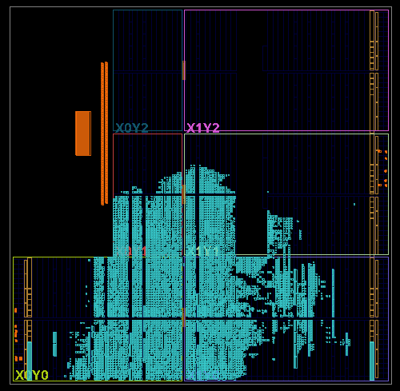

# STM32 主方案实现结果

这里维护用户外部工程的最新实现阶段报告，不复制运行数据库。10月19日报告与保留的10月18日截图属于不同候选。

| 文件 | 内容 |
|---|---|
| [timing_report_imp.txt](timing_report_imp.txt) | 2026-10-19 22:56:34，Routed：WNS +0.379 ns，WHS +0.036 ns |
| [utilization_report_imp.txt](utilization_report_imp.txt) | 2026-10-19 22:55:05，Fully Placed：LUT 13895、FF 14458、BRAM 25、DSP 41 |
| [drc_report_imp.txt](drc_report_imp.txt) | 最新Fully Routed DRC原件；保留警告及规则数量截断，不称零问题 |
| [布局布线图.png](implementation-layout.png) | 历史：2026-10-18导出，不代表10月19日布局 |

最新文本来源：用户工作工程`F:/AMD/work/SoundSight_STM32/SoundSight_STM32.runs/impl_1`，器件xc7z020clg400-2、Vivado 2025.2、顶层soundsight_stm32_bd_wrapper。时序报告的no_clock、unconstrained_internal_endpoints、no_input_delay、no_output_delay检查计数均为0；这不等于外部接口已测量、电气正确或CDC全面通过。

DRC报告包含DSP流水、RAM异步控制、无可布线负载等警告，且两类RAM规则达到报告上限；本次仅保留事实，没有修改RTL来消除它们。当前没有同候选的新专项CDC报告。

本次只归档用户已有报告，没有启动Vivado。文件身份见[本次记录](../../../document/evidence/stm32-handoff-20261019/artifact-identities.json)；磁盘源码和文件哈希不单独证明报告的全部输入或板上Flash内容。旧TXT通过Git历史追溯，不再堆一套副本。完整范围见[工程交接说明](../../../document/stm32-handoff.md)。

