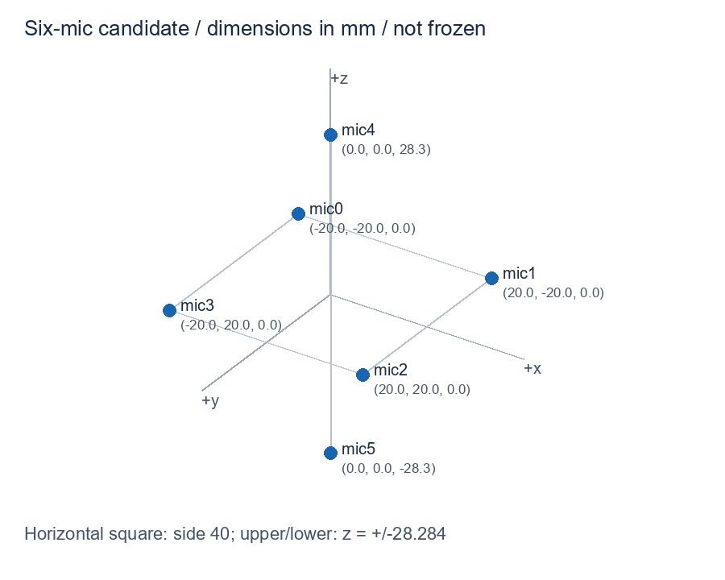
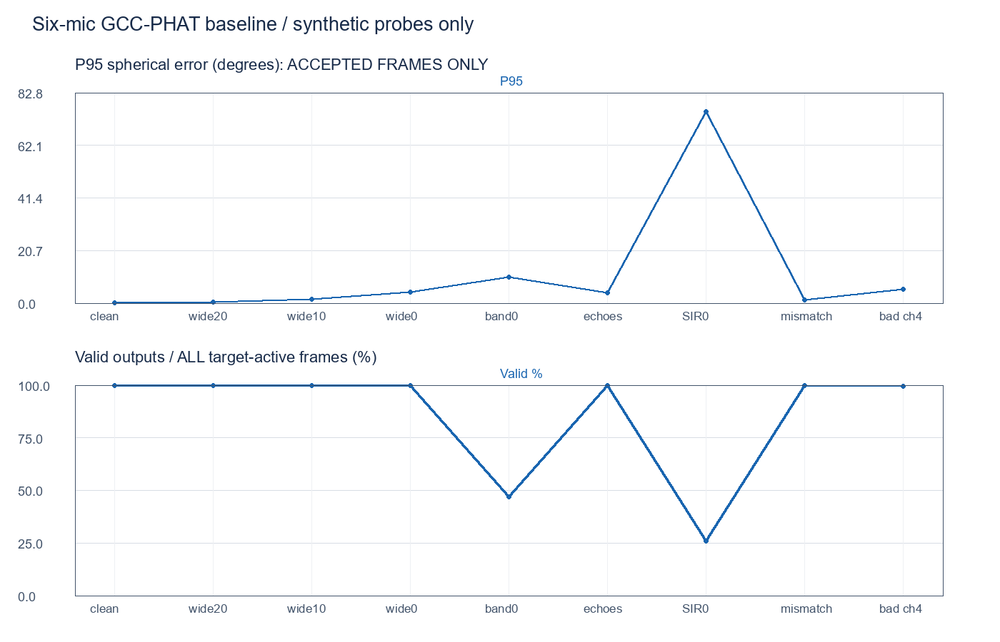
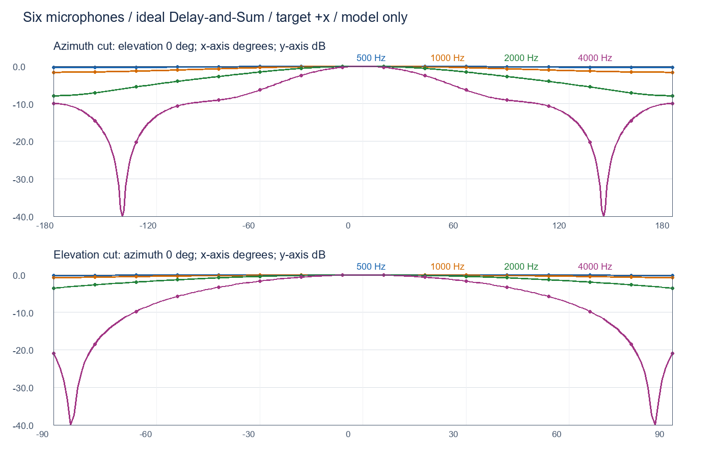

# 六麦声学软件预评审：第一轮结果

日期：2026-09-07。证据级别：浮点模型与合成信号。结论：六麦三维方向链路在理想单目标下可运行，但低带内信噪比和等强竞争声源下存在明显失败，暂不能通过完整3D-G0，更不是硬件验收。

## 1. 范围与决策

遵循用户最新要求，只模拟六麦，不运行四麦或四/六麦对照；V1四麦计划不改。麦克风沿用此前IM73D122V01/PDM路线，不重新选型。此处采用一致全向麦的理想传递函数，未模拟具体模块的声孔、封装、频响与PDM抽取链，不把器件典型SNR当作房间输入SNR。

六麦候选：水平40 mm正方形，中心上、下方各一麦，z=±28.284 mm；所有坐标在配置文件中，尺寸尚未据实物冻结。方向是指向声源的单位向量、方位和俯仰，不输出距离/离地高度。



## 2. 做了哪些计算

- 48 kHz、1024点Hann帧；15组GCC-PHAT/IFFT；300～4000 Hz频点限制、互谱幅度2%屏蔽、合法lag搜索和抛物线亚采样峰值。
- 基于已知坐标的无权最小二乘，原始向量模长0.7～1.3、时差拟合残差≤0.5采样才接受；这些参数预先选定，未按最终数据调参。
- 方位0～330°每30°、俯仰-60/-30/0/30/60°，共60个方向；每种场景5个随机样本，共9场景、2700帧。不是连续2700帧的跟踪试验。
- 声源距中心1.5 m，以精确球面距离合成各麦信号，再用远场DOA模型求解；分数延时采用频域相移，取信号内部帧以避开周期边界。
- 合成宽带噪声探针、独立噪声、两条可控反射、竞争声源、固定安装/延迟/增益误差，以及一路强噪声污染。没有天然语音、真实房间RIR或已标定RT60。
- 21个自检覆盖精确TDOA符号、波形级GCC正负轴/俯仰、六麦剔除任一整路后的几何秩、全零输入拒绝；剔除后的秩测试不代表自动坏通道检测或实物遮挡通过。

模型没有实现目标锁定、通道质量加权、自动异常通道剔除、SRP-PHAT或定点链；保留失败用于识别下一步工作，不把基线当最终算法。

## 3. 方向结果

P50/P95只统计被算法接受的帧，必须与“有效输出/所有目标活动帧”一起看。每行300帧；不是整空间连续覆盖承诺。

| 合成条件 | 处理频带内输入比值中位数 | P50 / P95球面误差 | 有效输出 |
|---|---:|---:|---:|
| 单目标，独立全频白噪声名义20 dB | 约28.03 dB | 0.22° / 0.47° | 100% |
| 单目标，独立全频白噪声名义10 dB | 约18.03 dB | 0.67° / 1.49° | 100% |
| 单目标，独立全频白噪声名义0 dB | 约8.03 dB | 2.12° / 4.34° | 100% |
| 单目标，同频带独立噪声约0 dB | 约0.00 dB | 4.82° / 10.20° | 47.00% |
| 两条简化反射＋低强度独立噪声 | 约29.06 dB，目标分量包含反射 | 1.50° / 3.94° | 100% |
| 两个等强竞争声源 | 目标/干扰约0 dB | 40.07° / 75.31° | 26.00% |
| 固定坐标±0.5 mm、增益±1 dB、延迟±0.1采样误差 | 约28.03 dB | 0.65° / 1.25° | 100% |
| 上方mic4叠加强独立噪声，未自动剔除 | 全六路平均约5.80 dB，掩盖通道差异 | 1.59° / 5.54° | 99.33% |

关键解释：

1. “全频白噪声0 dB”在300～4000 Hz处理后约为8 dB，不能冒称带内0 dB仍有100%有效率。真正同频带0 dB用例只有47%有效输出，未达到计划草案90%的候选门槛。
2. 等强竞争声源没有目标身份/锁定机制。相对指定目标，误差>30°的输出占所有目标帧17.33%，占有效输出66.67%。这是当前基线的目标选择与选峰失败，不证明六麦几何本身不可行，也不能用“声音更响”替代用户目标。
3. 近乎无噪声时极小的误差仅反映匹配良好的理想模型，不作为精度宣传。单套固定误差样本不能替代多次装配/多随机标定误差的统计。
4. 两条反射的振幅0.45/0.25、延迟3/7 ms是人为设定，不是房间混响测量，不能把该行解释为任何指定RT60下可靠。



## 4. 波束与音频

理想远场、指向+x、水平相差90°的单频干扰，在该六麦布局下的衰减为：500 Hz约0.19 dB、1 kHz约0.78 dB、2 kHz约3.08 dB、4 kHz约9.35 dB。低频方向选择仍很弱；增加上下麦并不自动消除小孔径限制。此处没有运行四麦比较。



另做一组六通道、3秒的合成音频：目标方位0°/俯仰30°，干扰方位90°/俯仰0°，两者距阵列1.5 m；目标为宽带噪声探针，干扰为1.5～4 kHz带限噪声且约低6 dB。去掉两端各0.25秒，导出2.5秒样本。

| 输出 | 目标/干扰比SIR | 相对固定单麦改善 |
|---|---:|---:|
| A：mic0单麦参考 | 5.99 dB | — |
| B：六麦手动真实方向 | 11.65 dB | 5.65 dB |
| C：六麦自动静态方向 | 11.28 dB | 5.29 dB |

C用81个有效帧方向的向量平均作为整段静态指向，误差约4.05°；共尝试186帧，有效比例仅43.55%，不能用整段C音频掩盖在线定位大量拒绝的问题。这不是逐帧在线跟踪。输出共用同一增益，未分别归一化掩盖音量变化；指标按量化前已知目标/干扰分量计算，WAV为16 bit。原六通道输入一并保存。这是单个有利带限干扰场景，不是自然语音清晰度、房间平均SNR或V1“4 dB”实测验收。

音频与数据：[六通道合成输入](results/six-channel-synthetic-input.wav)、[A单麦](results/A-single-reference.wav)、[B手动](results/B-manual-direction.wav)、[C自动静态](results/C-auto-static-direction.wav)。这些是噪声测试音，不是语音。

## 5. 评审结论与未通过项

本轮已完成六麦浮点第一基线，支持继续研究该六麦候选，但不批准硬件冻结。3D-G0只能登记“部分模型证据已形成、失败条件已发现”。

后续改进优先级：先明确目标扇区/锁定与重捕获规则，再比较通道对质量加权、错误峰拒绝和必要时的SRP-PHAT；低带内SNR下需同时改善精度与有效率，不能只通过大量拒绝降低误差。上述是建议，当前脚本未假装已实现。

仍缺：自然语音和真实房间RIR/录音、更广泛距离与高度、分布式标定误差、静音环境误报率、物理遮挡/模块方向性、自动异常通道识别、连续跟踪与延迟、PDM抽取/定点误差，以及完整FPGA资源/周期/时序预算。原全pair的6 FFT＋15 IFFT只是一部分运算计数，软件运行耗时不等于PL时限验证。

## 6. 复现和文件

- [模型入口](src/six_mic_acoustic_review.py)：仅六麦，不修改RTL/Vivado/采集合同，依赖现有NumPy和Pillow，无额外安装。
- [机器可读配置](results/config.json)：坐标、采样率、频带、种子、场景、阈值、源码哈希和环境版本。
- [逐帧记录](results/direction-trials.csv)、[分方向记录](results/direction-bins.csv)、[汇总](results/direction-summary.csv)、[自检](results/self-tests.json)。
- [英文结果说明](results/SUMMARY.md)、[音频指标](results/audio-demo.json)、[产物SHA-256](results/manifest.json)。

```powershell
python src/six_mic_acoustic_review.py --out reproduced-results --repeats 5
```

运行会重新生成指定目录中同名模拟产物；换一个空目录可做独立复跑。文档中的结果是本脚本的合成模型计算，不引用外部项目性能作为本项目证据。

验证记录：21个自检通过，2700帧结果保存；在独立临时目录复跑并比较15个产物SHA-256，检查全部一致；三张图已逐张查看，标签和数据范围可读。上述检查证明本轮计算可复现，不证明声学指标全面通过。
